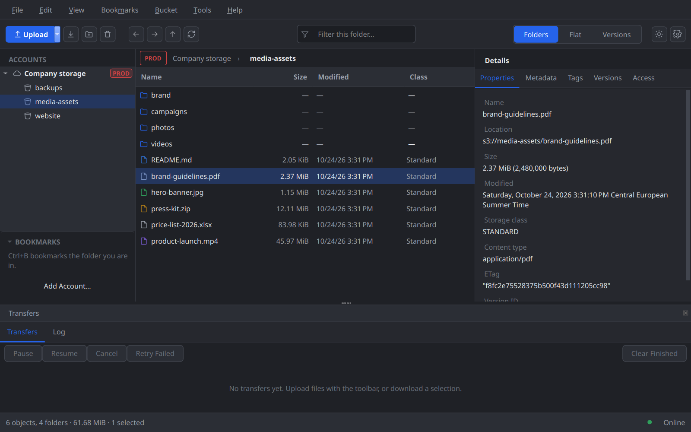
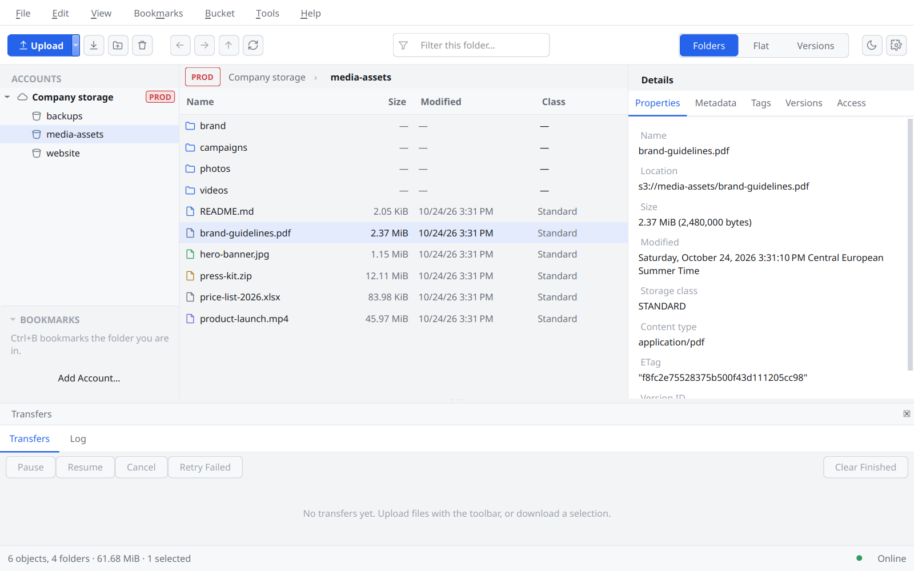

# QBucket

A native desktop browser for **S3 and S3-compatible object storage** —
Hetzner Object Storage, Ceph RGW, AWS S3, Garage and others. Windows and
Linux, MIT-licensed, built with C++20 and Qt 6 Widgets.



**Version 1.0.0** — on par with the essentials of NetSDK's S3 Browser:

- **Accounts** with the secret in the system keychain only; provider presets;
  import from the AWS CLI's files and rclone.
- **Browsing** buckets and folders of any size, object details, bookmarks and
  recent locations, presigned links, folder sizes.
- **Transfers** of any size: multipart, verified by MD5, resumable after a
  quit or a crash; drag & drop in from the file manager and out into Explorer
  (virtual files) or a Linux file manager.
- **Changes**: new folder, delete, rename, copy / move (also between
  buckets), headers, metadata, storage class, tags, canned ACLs; open an
  object in its default application and upload the changes.
- **Versions**: browse, download, restore, delete for good, undelete; the
  versioning switch.
- **Buckets**: policy, CORS, lifecycle rules, ACL, public access block,
  object lock with retention and legal hold; create and delete.

What changed: [CHANGELOG.md](CHANGELOG.md).



## Built for production data

- Every change is **planned, previewed, executed, verified and journaled**;
  its scope comes from a fresh listing, never from what the view shows.
- The server's **capabilities are probed** (read-only) and kept fresh; an
  action the server doesn't support can't be triggered, and the reason is
  shown. A read never unlocks a write.
- **Never blocks the UI**, also with millions of objects.
- The S3 layer is a reusable library: [`libs/qbucket-s3`](libs/qbucket-s3).

## Install

| Platform | Package |
|---|---|
| Windows 10 / 11 (x64) | `qbucket-1.0.0-windows-x64-setup.exe` (per user or for all users) or the ZIP |
| Ubuntu 26.04 | `sudo apt install ./qbucket_1.0.0-1_amd64.deb` |
| Any Linux with Flatpak | `flatpak install --user qbucket-1.0.0-x86_64.flatpak` (KDE runtime 6.10 from Flathub) |

From the release page. `qbucket --self-test` checks an installation without
opening a window: Qt, sandbox, paths and a round trip through the keychain.
Without a keychain service (no Secret Service / KWallet on Linux) QBucket
asks for secrets once per session and keeps them in memory — never in a
file.

## Providers

The server's capabilities are probed per account and bucket; this table is
what the integration tests found on real servers (`it_s3_backend`,
`it_operations`; details in
[`it-expectations/`](libs/qbucket-s3/tests/data/it-expectations) and
[docs/providers/hetzner.md](docs/providers/hetzner.md)).

| | Hetzner | Ceph RGW 19.2 | Garage 2.4 | VersityGW 1.9 | AWS S3 |
|---|---|---|---|---|---|
| Transfers, multipart, resume | ✓ | ✓ | ✓ | ✓ | ✓ |
| Object tags | ✓ | ✓ | — | ✓ | ✓ |
| Object ACLs | ✓ | ✓ | — | — | ✓ |
| Versions | ✓ | ✓ | — | ✓ | ✓ |
| Bucket policy | ✓ | ✓ | — | ✓ | ✓ |
| CORS | ✓ | ✓ | ✓ | ✓ | ✓ |
| Lifecycle rules | ✓ | ✓ | ✓ | — | ✓ |
| Public access block | ✓ | ✓ | — | — | ✓ |
| Object lock (governance) | ✓ | ✓ | — | ✓ | ✓ |
| Safe overwrite (If-Match) | HEAD check | HEAD check | HEAD check | ✓ | ✓ |

Hetzner was tested in nbg1 (copies between buckets of one project included),
the others in Docker. AWS S3 follows the protocol's reference behaviour but
has not been run against yet. "HEAD
check": the server can't be trusted with If-Match on writes, so a replace
checks the object right before writing (a small window remains). Any other
S3-compatible server works with the generic profile; its capabilities come
from the probes.

## Building

Requirements: CMake ≥ 3.22, a C++20 compiler (MSVC 2022, GCC 12+, Clang 16+),
Qt ≥ 6.5 with Widgets, Svg and LinguistTools (and DBus on Linux), QtKeychain
(found, or fetched by CMake).

```sh
cmake -S . -B build -G Ninja -DCMAKE_BUILD_TYPE=Release
cmake --build build
ctest --test-dir build --output-on-failure
```

On Windows the top-level `CMakeLists.txt` auto-detects Qt under `H:/Qt` or
`C:/Qt`; elsewhere pass `-DCMAKE_PREFIX_PATH=/path/to/Qt/6.x/gcc_64` if Qt
isn't found. Useful options: `-DQBUCKET_WARNINGS_AS_ERRORS=ON`,
`-DQBUCKET_SANITIZERS=ON` (GCC/Clang), `-DQBUCKET_BUILD_TESTS=OFF`.

The packages, built and tested in Docker (nothing else needed on the host):

```sh
packaging/debian/build-in-docker.sh     # .deb for Ubuntu 26.04
packaging/flatpak/build-in-docker.sh    # Flatpak bundle
```

and on Windows `packaging\windows\build-release.ps1` (ZIP and Inno Setup
installer). See [docs/RELEASING.md](docs/RELEASING.md).

## Documentation

- [CHANGELOG.md](CHANGELOG.md) — what changed per version
- [PLAN.md](PLAN.md) — decisions, architecture, milestones, safety and
  performance rules
- [docs/RELEASING.md](docs/RELEASING.md) — checks, packages, publishing
- [CLAUDE.md](CLAUDE.md) — conventions for contributors (human or AI)
- [docs/devlog/](docs/devlog/) — development log, one entry per step

## License

MIT — see [LICENSE](LICENSE).
