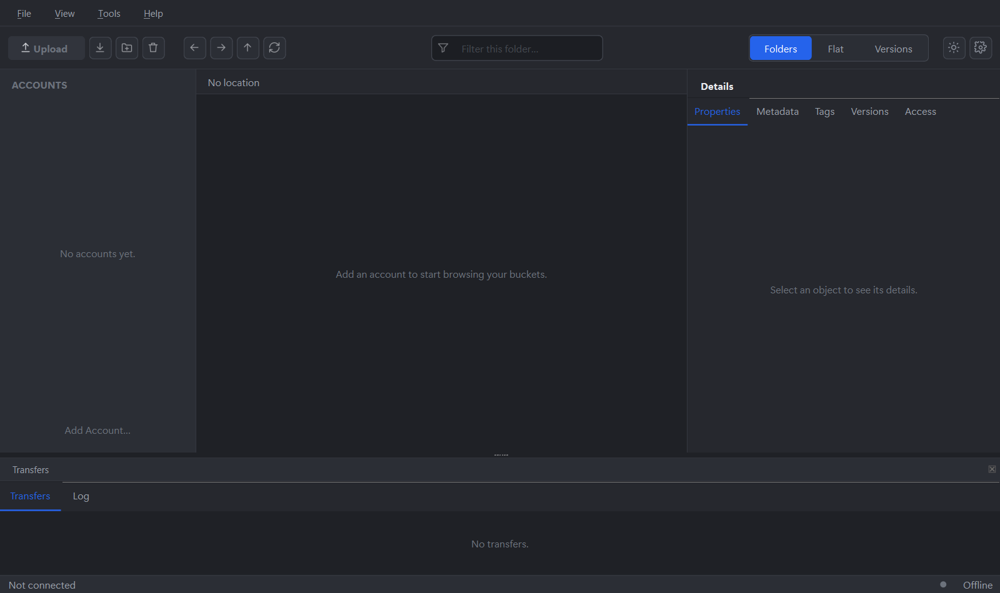

# QBucket

A native desktop browser for **S3 and S3-compatible object storage** —
Hetzner Object Storage, Ceph RGW, AWS S3 and others. Windows and Linux,
MIT-licensed, built with C++20 and Qt 6 Widgets.

> **Status: early development (M0 — skeleton).** The main window, the light
> and dark theme and the build/packaging pipeline are in place; S3
> connectivity arrives with milestone M1. See [PLAN.md](PLAN.md).



## Goals

- Feature yardstick: NetSDK's S3 Browser — buckets, objects, multipart
  transfers with resume, versioning, policies, CORS, lifecycle, object lock.
- **Built for production data:** every destructive operation is planned,
  previewed, executed, verified and reported; the server's capabilities are
  probed automatically and unsupported actions can't be triggered.
- **Never blocks the UI**, also with millions of objects.
- The S3 layer becomes a reusable library (`libs/qbucket-s3`, from M1).

## Building

Requirements: CMake ≥ 3.22, a C++20 compiler (MSVC 2022, GCC 12+, Clang 16+),
Qt ≥ 6.5 with Widgets, Svg and LinguistTools.

```sh
cmake -S . -B build -G Ninja -DCMAKE_BUILD_TYPE=Release
cmake --build build
ctest --test-dir build --output-on-failure
```

On Windows the top-level `CMakeLists.txt` auto-detects Qt under `H:/Qt` or
`C:/Qt`; elsewhere pass `-DCMAKE_PREFIX_PATH=/path/to/Qt/6.x/gcc_64` if Qt
isn't found. Useful options: `-DQBUCKET_WARNINGS_AS_ERRORS=ON`,
`-DQBUCKET_SANITIZERS=ON` (GCC/Clang), `-DQBUCKET_BUILD_TESTS=OFF`.

### Flatpak

```sh
flatpak-builder --user --install --force-clean build-flatpak \
    packaging/flatpak/io.github.theinvisible.QBucket.yml
flatpak run io.github.theinvisible.QBucket
```

## Documentation

- [PLAN.md](PLAN.md) — decisions, architecture, milestones, safety and
  performance rules
- [CLAUDE.md](CLAUDE.md) — conventions for contributors (human or AI)
- [docs/devlog/](docs/devlog/) — development log, one entry per step

## License

MIT — see [LICENSE](LICENSE).
