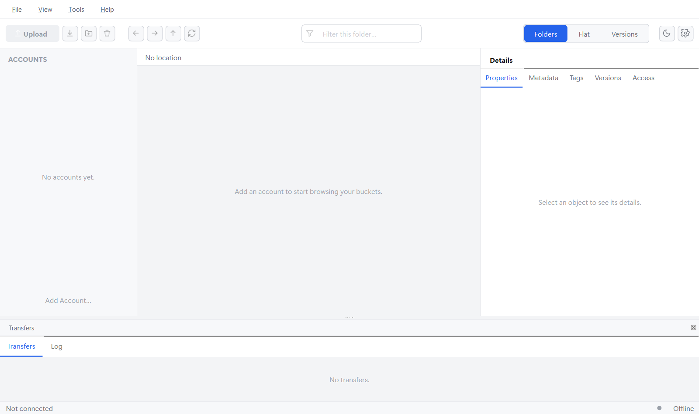

# Devlog 001 — M0: skeleton & design system

**Date:** 2026-10-20

## What was built

The empty but complete application frame — everything M1 onwards plugs into.

- **CMake skeleton** with the Qt auto-detection from xyz-profiler and a
  shared `qbucket::compile_options` target: Qt strictness defines
  (`QT_NO_CAST_FROM_ASCII`, `QT_NO_NARROWING_CONVERSIONS_IN_CONNECT`,
  deprecations up to 6.5 disabled …), `/W4 /permissive-` resp.
  `-Wall -Wextra`, optional warnings-as-errors and ASan/UBSan. Code is split
  into small static libraries (`qbucket_diagnostics`, `qbucket_controllers`,
  `qbucket_ui_foundation`, `qbucket_app_ui`) so tests link exactly what
  they check.
- **Design system port** from xyz-profiler: `Theme` (palette tokens
  identical), `DarkFusionStyle` (QSS template + QBucket additions for
  sidebar, path bar, empty states, transfer dock), `IconFactory` (generic
  icons + 21 new ones: bucket, folder, upload, download, lock, key, shield,
  …). New: `ThemeManager`, which also follows the OS colour scheme live when
  "System" is selected.
- **Main window** with the full layout from PLAN.md §4: toolbar (Upload,
  Download, New folder, Delete, Back/Forward/Up/Refresh, filter, segmented
  Folders | Flat | Versions, theme toggle, settings), sidebar, object list
  with fixed `Interactive` column widths, detail pane with five tabs,
  transfer dock (Transfers | Log), status bar. Every action that would
  change data is disabled — it gets enabled only once it runs through the
  `OperationController` (§12.1).
- **Settings**: `SettingsController` (theme, browse mode, window and splitter
  state; splitter writes debounced at 300 ms, flushed on quit; hand-edited
  INI values normalised on load) and a `SettingsDialog` in the xyz-profiler
  sidebar look.
- **Stall watchdog**: a precise 20 ms heartbeat on the GUI thread that logs
  every event-loop stall > 50 ms (`qbucket.stall`). On by default in debug
  builds — the development guard for "the UI never blocks".
- **i18n**: English source strings, complete German translation (65 strings,
  informal "du" as in xyz-profiler).
- **Packaging**: app icon (SVG master + `make_icon.ps1` generating the
  7-size `.ico` from the same geometry), `.desktop` file, AppStream
  metainfo, Flatpak manifest (`org.kde.Platform` 6.10), Linux install rules.
- **CI** (`.github/workflows/ci.yml`): Windows MSVC Release, Linux GCC
  Release, Linux ASan + UBSan, clang-tidy, Flatpak build.
- **Tests** (4 binaries, all green in Debug and Release on Windows):
  design tokens / stylesheet / every icon renders, settings normalisation
  and persistence, stall detection, and a main-window smoke test that also
  produces the screenshots above.

## Decisions

- **QtKeychain moved from M0 to M1.** It is first used by `SecretStore` and
  brings libsecret into the Linux and Flatpak builds; validating that
  together with the code that needs it, on Linux, is the better place.
- **CMake minimum 3.22** (was 3.21) for `ENVIRONMENT_MODIFICATION` in tests.
- **Fonts**: the design font (Segoe UI Variable) only on Windows; on Linux
  the desktop's own UI font is used.
- **Detail tab "Headers & Meta" → "Metadata"** — shorter, and the `&` was
  being read as a mnemonic.

## Pitfalls

- **Theme switch re-polished everything, every time.** The ported
  "install Fusion only once" check compared `QApplication::style()->name()`
  with "fusion" — but once a stylesheet is set, `style()` is Qt's internal
  `QStyleSheetStyle` proxy with an *empty* name, so Fusion was re-created on
  every switch. Found by a unit test; fixed with a static flag; regression
  test `themeSwitchKeepsTheStyleObject`. xyz-profiler very likely has the
  same bug.
- **Tests next to the deployed exe crash with a modal dialog.** windeployqt
  copies a trimmed Qt (only the `windows` platform plugin) next to
  `qbucket.exe`. Tests in the same directory loaded that copy, couldn't find
  `offscreen`, and the debug CRT showed "no Qt platform plugin could be
  initialized" — blocking. Tests now build into `build/tests/`.
- `PATH=a;b` in a test's `ENVIRONMENT` property is split as a CMake list;
  `ENVIRONMENT_MODIFICATION … path_list_prepend` is the correct tool.
- Structured bindings captured in lambdas need Clang ≥ 16; avoided so the
  clang-tidy job doesn't depend on the runner's Clang version.

## Measurements (Windows, MSVC 2022, Qt 6.12.0)

- Build: clean, zero warnings at `/W4 /WX`; clang-tidy (LLVM 23): 0 findings.
- `qbucket.exe` Release: 225 KB; deployed folder incl. Qt runtime ≈ 68 MB
  (windeployqt also ships `dxcompiler.dll` / `dxil.dll` — to trim in M8).
- Test runtime: < 2 s for all four binaries.

## Open / to verify on Linux (start of M1)

- CI has not run yet — first push of this branch will exercise all five
  jobs. In particular unverified: the Flatpak container tag
  `kde-6.10`, the KDE runtime version in the manifest, the GCC `-Werror`
  build and the sanitizer job.
- `appstreamcli validate` / `desktop-file-validate` for the metainfo and
  `.desktop` file.
- Screenshots on Linux (xcb/wayland) to check the system-font fallback.
