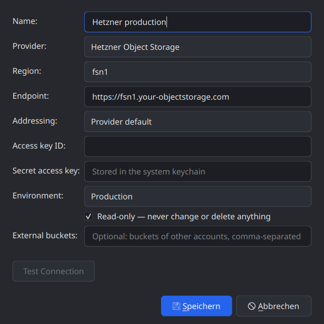
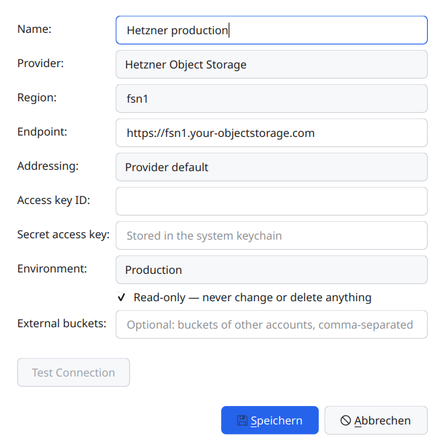

# Devlog 003 — M1: S3 protocol core, accounts and keychain

**Date:** 2026-10-20

## What was built

M1 in 14 committed stages on `main`, developed on Linux (Ubuntu 26.04,
GCC 15, Qt 6.10.2). The Hetzner validation (stage 15) is still open — see
below.

**`libs/qbucket-s3`** — the reusable library (PLAN.md §3.0), ~6.5k lines plus
~4.3k lines of tests:

- Standalone CMake project (static or shared, export header, installed
  `QBucketS3` package); the `s3-standalone` CI job builds it alone
  (Linux static/shared, Windows shared, ASan+UBSan+LSan) and builds `s3ls`
  against the installed package.
- `Result<T>` / `Error` with `ErrorCategory` — no exceptions.
- `S3Uri`: exact request targets, path-style / virtual-hosted with the
  usual fallbacks; the URL QNAM gets is checked against what is signed.
- `SigV4Signer` + `Presigner`, validated against the vendored AWS SigV4
  test suite (aws-c-auth, Apache-2.0, 30 cases in header and query mode)
  and the S3 documentation examples.
- XML parsers (root element checked, `encoding-type=url` decoded wherever
  `<EncodingType>` appears), error mapping (S3 code first, HTTP status
  second), redaction, logging categories, `RequestObserver`.
- `testing::FakeS3Server` (`qbucket::s3_testsupport`): scriptable HTTP/1.1
  server with fault injection and SigV4 verification from the received
  bytes — every client test runs against it.
- `RequestPipeline` + `S3Client` (private): ListBuckets (paged),
  ListObjectsV2/V1, Head/Get/Put/Delete object, DeleteObjects,
  Create/DeleteBucket, GetBucketLocation; Content-MD5 everywhere,
  200-with-error for flagged operations, MD5 check on GET where the ETag
  is an MD5 (`Integrity::Md5Verified` vs `SizeVerified`).
- Safe retries (transient + idempotent, or provably never sent; full
  jitter; `Retry-After`), clock-skew correction (also from a bare 403 on
  HEAD), region redirects (header or `<Region>`, never `Location`).
- `Session` — the public entry point: worker thread with its own QNAM,
  callback + context API (`RequestId`, exactly-once queued delivery,
  dropped when the context dies), cancel, non-blocking `shutdown()`.
  `ListObjectsPager` detects listing loops across pages.
- Provider profiles + registry: Hetzner (first), AWS, Garage, generic.
- Capability safeguard (§3.3): `Feature` / `CapabilitySet` with
  fingerprint and bucket state, JSON persistence, merge/diff/expiry, 21
  read-only probes (four in parallel), a local short-circuit for
  Unsupported features, learning from real 501s.
- Docker test backends (Ceph RGW, VersityGW, Garage) with one command
  (`tests/docker/it-up.sh`, ~25 s) and `it_s3_backend`; a second workflow
  runs it in CI on library changes.
- `examples/s3ls`: `buckets`, `ls`, `probe`, `--dump-responses`.

**App:**

- QtKeychain integration (`cmake/QBucketQtKeychain.cmake`), `SecretStore`
  (keychain only; session-only mode without a backend — never plaintext),
  `AccountStore` (own `accounts.ini`), `KeychainCredentialsProvider`.
- `ConnectionTester` + `AccountDialog` ("Add Account…" is live): Hetzner
  preselected, region fills the endpoint, Production starts read-only,
  secret saved before the account. German translation complete.

Tests: 21 library unit test binaries + the integration test (×3 Docker
backends), 9 app test binaries — all green in Debug, Release, shared and
ASan+UBSan+LSan builds. Library unit suite: ~18 s.

## Decisions

- **Session API = callback + context** (asked and decided before the
  start): `RequestId listObjects(params, QObject* context, Callback<T>)`.
  Simpler than signals-per-operation, deterministic, no QFuture edge cases.
- **`S3Client` stays private in M1.** `Session` is the only public entry
  point, so there is one API to keep stable before 1.0.
- **Exactly-once delivery by ownership:** whoever takes a request out of
  the registry owns its delivery — the worker, `cancel()` or teardown. The
  worker therefore never posts to a dangling object, and `cancel()`
  delivers *Cancelled* immediately instead of waiting for the network.
- **Stop-gap Ceph image** (teran/ceph-container v19.2.6, digest-pinned);
  own Containerfile later. No HTTPS there yet, so SSE-C can't be tested.
- **Deviations of a backend are asserted, not skipped**
  (`tests/data/it-expectations/<backend>.json`): when a backend changes,
  the integration test notices.
- **Provider knowledge only in profiles** — also for probes:
  `ProviderProfile::reviewProbe()` corrects answers a provider is known to
  give misleadingly.
- **QtKeychain find-first:** an installed package only if it belongs to the
  same Qt prefix, else a pinned FetchContent build; the Flatpak builds it as
  a manifest module (the build is offline). A FetchContent build without
  libsecret fails instead of silently dropping GNOME support.
- **Work happens directly on `main`** during this early phase (user's call).

## Pitfalls found (all with tests now)

- **QNAM normalises `.` / `..` path segments on the wire** — even
  `%2E%2E`, although `QUrl::path()` still shows them. A key `a/../b` would
  have addressed `b` (a DELETE would have hit the wrong object). Such keys
  are now refused with `InvalidRequest`.
- **Leak in the worker teardown:** an object destroyed during a thread's
  final deferred-delete pass called `deleteLater()` on a child; that is
  never processed, so the child kept the whole thread data alive. Found by
  LeakSanitizer (the app's sanitizer job runs with leaks off).
- **moc mis-reads raw string literals** with quotes in `Q_OBJECT` files —
  empty `.moc`, "undefined vtable". XML fixtures live in `tests/data/`.
- **HEAD has no body:** region redirects and clock skew show up there only
  as status + headers; both paths handle that now.
- **TSan needs a TSan-instrumented Qt.** With a stock Qt every queued
  hand-off is reported and the runtime even aborts on thread creation —
  the TSan job is deferred.

## Provider findings

| Backend | Finding |
|---|---|
| Ceph RGW 19.2 | `?ownershipControls` ignored — answered with a bucket listing (the "ignored subresource" case of §3.3); website off by default (405) |
| VersityGW 1.9 (posix) | `a//b` is stored as `a/b` (overwrites!); control characters in keys come back as U+FFFD; many subresources 501 |
| Garage 2.4 | wrong secret → 403 AccessDenied "Invalid signature" (mapped to Authentication); `GET ?versioning` is a stub — `PUT ?versioning` is 501 (profile override); `GET ?website` answers 204 |

## Open

- **Stage 15 — Hetzner:** run `it_s3_backend` and `s3ls probe` against the
  one available region, capture redacted fixtures with `s3ls
  --dump-responses`, write `docs/providers/hetzner.md`, confirm or correct
  `HetznerProfile::capabilities()`, add `it-expectations/hetzner.json`.
- **CI has not seen M1 yet** (nothing pushed): Windows MSVC (shared library
  exports, QtKeychain FetchContent), the libsecret FetchContent path on
  Linux, the Flatpak `qtkeychain` module and the new integration workflow.
- TSan job with an instrumented qtbase.
- Own Ceph Containerfile with HTTPS (SSE-C probes) and a second Ceph version.
- Flatpak: verify the keychain through the Secret portal on GNOME and KDE.
- Design system: combo boxes have no visible drop-down arrow (since M0).
