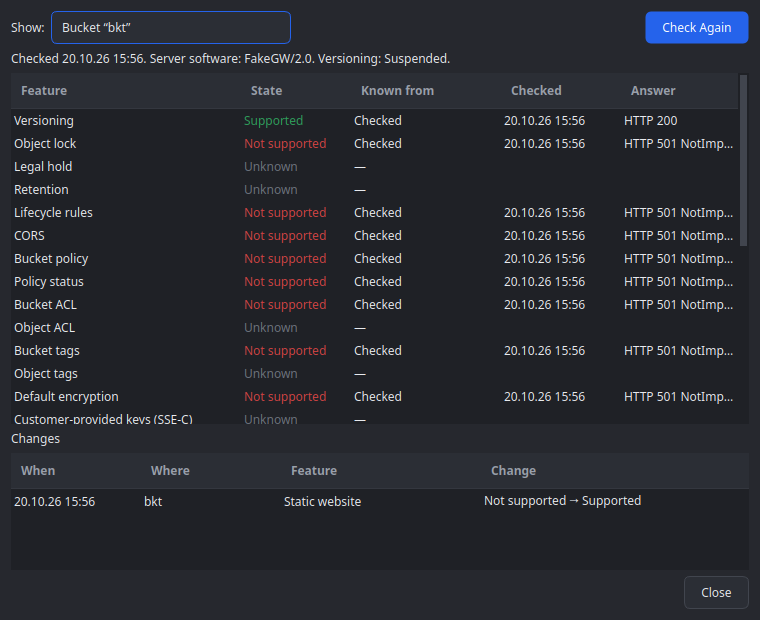

# Devlog 005 — M2: Browser UI

**Date:** 2026-10-20

## What was built

The browser UI on top of the M1 library, and the first mutations through
one gate (PLAN.md §6 M2, §12, §13). Twelve stages on `main`, each a commit
with ctest green:

| Stage | Commit | What |
|---|---|---|
| 1 | `30a8816` | `AccountSessions` (one `s3::Session` per account, lazy, keychain credentials, clock offset handed on, non-blocking stop), `CapabilityStore` (JSON per account/bucket) |
| 2 | `60c7462` | `AccountTreeModel` + `AccountSidebar`: accounts → buckets lazily, external buckets, loading / error / empty / forbidden as status rows, environment badge and read-only lock, edit / remove / external-bucket menu, secret prompt |
| 3 | `4adcc85` | `ObjectTableModel`: pages of 1000, compact rows, folders first, folder + flat mode, server-side prefix search, own sort (natural names; large sorts on the thread pool, applied with `layoutChanged`) and live filter; `tests/support/FakeBucket` |
| 4 | `e8db7a4` | `ObjectBrowser`, `BrowseController` (back / forward / up), `PathBar` (crumbs, folded deep paths, Ctrl+L), listing cache (stale until re-listed), status bar |
| 5 | `279f80a` | `ObjectRowDelegate` (icons by file type, storage-class badges), `DetailPane` (HeadObject once the selection rests; properties, all headers, user metadata) |
| 6 | `ac718c7` | Edit menu and list keys (Ctrl+C key, Ctrl+Shift+C URI, Backspace, F5 by focus), `QTableView` for objects, `bench/bench_listing` |
| 7 | `0ec5b3d` | `CapabilityController` (load → session, probe on connect / bucket open, re-validation, asymmetric merge, change history, `decide()` / `reason()`, `ensureFresh()`), Tools → Server Capabilities, Log tab |
| 8 | `a184978` | The gate: `OperationController`, `Job` (plan → preview → execute → verify → report), `Journal` (JSONL), `OperationPreviewDialog` (production tick, typed confirmation), `tools/check-mutation-gate.sh` |
| 9 | `e2acaaf` | `CreateFolderJob`; `tests/it_operations` (the app's jobs against real servers) |
| 10 | `11d8bb1` | `DeleteJob` (fresh plan into a `PlanFile`, batches or single deletes, verify with re-checks, "Retry Failed") |
| 11 | `c6890ef` | `Session::copyObject` in the library; `RenameJob` (copy → verify → delete, per object) |
| 12 | this entry | Hetzner run, cross-bucket copy, English plural forms, `it_browser`, docs |

## Decisions and why

- **The model sorts and filters itself — no `QSortFilterProxyModel`.** A
  proxy sorts synchronously on the GUI thread through `data()` calls; with
  100k rows and natural name comparison that is far beyond 50 ms. The
  model keeps a display order (`m_order`) and a filtered view (`m_view`)
  over compact rows; sorts of more than 5 000 rows run on the global thread
  pool on a snapshot of sort keys and are applied with `layoutChanged`
  (persistent indexes follow, so the selection survives). Pages arriving
  while sorted are appended, then sorted in by the next background pass.
- **Paging is the browser's decision (`loadMore`), not `fetchMore`.**
  `QTreeView` calls `canFetchMore`/`fetchMore` on the root from every
  layout pass (`QTreeViewPrivate::layout`); with asynchronous pages that
  quietly paged through whole buckets. The browser asks when the last row
  is within three viewport heights (measured with `visualRect`, which
  forces the pending layout — the scroll bar still reads "at the end" right
  after a page arrived), and on viewport resizes.
- **`QTableView` for the object list.** `QTreeView` keeps an item per row
  and relays all of them out after every inserted page: 47 ms per page at
  1M rows, 9–12 ms with the table (bench).
- **Listing cache, but never passed off as current.** Revisited locations
  show their cached rows at once with a "Showing the listing from … —
  refreshing…" banner; the same pages are listed afresh in the background
  and swapped in with one reset (the current row is restored by key). A
  failed refresh keeps the rows *and* the stale marker.
- **One `Job` shape for every mutation.** Create folder, delete and rename
  are `Job` subclasses driven by the `OperationController`: gate check
  (read-only, capabilities) before planning and again on confirmation;
  destructive jobs re-probe the bucket first when its results are older
  than a minute — a failed probe refuses the job. Cancelling before
  execution sends nothing; while executing, the requests in flight finish
  and the report says what was done.
- **Plans live on disk.** Bulk jobs write the keys of a fresh listing to a
  `PlanFile` (percent-encoded records, I/O on its own thread) and execute
  batch by batch from it — memory stays bounded at any size.
- **Deleting uses DeleteObjects only where `BatchDelete` is confirmed**
  (Hetzner, AWS, Garage profiles), single DeleteObject calls otherwise —
  "unknown" never unlocks the batch write.
- **Rename = copy → verify → delete, per object**, with
  `x-amz-copy-source-if-match` (a source changed since the plan is not
  touched), the storage class passed along (a COPY directive does not keep
  it), and the copy checked by size and — for single-part objects — ETag
  before the source is deleted. Never overwrites; objects above 5 GiB stop
  the plan (UploadPartCopy arrives with M3/M4); object ACLs are not copied
  and the preview says so.
- **Deviations from PLAN.md M2:** Ctrl+V (paste = copy/move) moves to M4
  with the object operations; Ctrl+C copies keys / URIs. Versions view
  stays disabled until M5.

## Hetzner (nbg1)

- `it_s3_backend` against `qbucket-it-test`: **14/14** (2 skipped as in
  M1), with the new CopyObject case — content and metadata copied,
  a stale `x-amz-copy-source-if-match` answered with 412 and nothing
  written.
- **Copying between buckets works**, although Hetzner's "supported
  actions" page says CopyObject works within one bucket only:
  `qbucket-it-test` → `qbucket-it-lock` copied and read back intact, twice
  (`crossBucketCopy`, opt-in with `QBUCKET_IT_SECOND_BUCKET`).
  `HetznerProfile` now says Supported, the expectations files say
  `"crossBucketCopy": true` so a change on Hetzner's side shows up. Either
  way it is safe: a refused copy is an error, and no job deletes a source
  whose copy failed.
- `it_operations` against **both** buckets (`qbucket-it-test` with
  versioning, `qbucket-it-lock` with object lock): create folder, delete a
  folder recursively (DeleteObjects batches — Hetzner's profile confirms
  BatchDelete), rename an object and a folder — all verified on the first
  pass, no stale reads this time.
- `it_browser`: the real main window with a read-only Production account
  lists the bucket, opens `guard/`, shows the guard object's details; the
  delete and rename actions are disabled with the read-only reason.
  Screenshots: `img/browser-hetzner-dark.png`, `img/browser-hetzner-light.png`.
- The guard objects `guard/DO-NOT-DELETE.txt` are still in both buckets
  (checked read-only before and after with `s3ls`).

## Measurements

`bench/bench_listing` (built with the tests, not run by ctest), release
build, offscreen platform, this Linux box, against a FakeS3Server on its
own thread; the GUI runs the real `ObjectBrowser`. All within PLAN.md
§13.4:

| Metric | Value | Budget |
|---|---|---|
| First rows after setLocation (incl. local round trip) | 11 ms | < 100 ms |
| Longest GUI stall while paging 100k | 4 ms | < 10 ms per page |
| Memory per 100k loaded rows | 26.7 MB | < 40 MB |
| Theme switch with 100k rows | 6 ms | < 150 ms |
| GUI stall during a background sort of 100k | 8 ms (sort: 21 ms) | < 50 ms |
| Longest GUI stall while paging a 1M flat listing | 12 ms (QTreeView: 47 ms) | < 50 ms |
| Worst scroll step through 1M rows | 3 ms | 16 ms |

Library tests and the app suite also pass under ASan + UBSan +
LeakSanitizer; the library builds and passes as a shared library
standalone.

## Pitfalls

- **QTreeView pages through everything** (see above) — any model with an
  asynchronous `fetchMore` behind a `QTreeView` has this problem.
- **The server fingerprint changed with every probe.** Its request-id
  "shape" carried the length of non-hex ids; the fake server's counter ids
  ("FAKE9" → "FAKE10") — and any real server with variable-length ids —
  then looked like different server software each time, and
  `capabilities::merge` threw all definitive results away: a 503 probe
  erased a known "Supported". Found by `test_capability_controller`; fixed
  in the library (`other`, no length) with a regression test.
- **Focus is lost when the list is swapped for "Loading…"** — Backspace
  after opening a folder did nothing. The message page now holds the
  focus and hands it back; Backspace is a browser-wide shortcut.
- **Two F5 shortcuts are none.** A window shortcut (View → Refresh) and a
  widget shortcut on the sidebar make Qt report an ambiguity and fire
  neither; one shortcut now refreshes the side that has the focus.
- **A job must be "awaiting confirmation" before it asks.** A slot that
  confirms synchronously inside `previewNeeded` found the job still in
  "planning" and the confirmation was dropped.
- **`QAbstractItemModelTester` re-checks the whole model on every change**
  — 30 s instead of 0.1 s with thousands of rows; it also calls
  `fetchMore` from its reset handler, so a `fetchMore` that inserts rows
  synchronously trips it (the account tree now queues the listing).
- **Tests and `deleteLater`**: finished jobs delete themselves from the
  event loop; a `QTRY_*` or `qWait` after `finished` must not touch the job
  any more (ASan found two such test bugs), and a set of job addresses
  needs clearing per test — freed addresses are reused.
- `QVERIFY2(r, qPrintable(r.error().toString()))` evaluates the message
  even when the check passes — `error()` asserts on a success.

- **Theme names are "Dark" / "Light" / "System".** Several tests passed
  "dark" / "light" and painted only the dark theme; caught by the light
  screenshot.
- **"1 object(s)"**: without an English translation Qt shows plural source
  texts as they are. `translations/qbucket_en.ts` (plural forms only,
  `PLURALS_TS_FILE`) is loaded first, the locale's file after it;
  `test_translations` checks both `.qm` files.

## Open points

- Ctrl+V (paste = copy / move between locations) — M4, with the object
  operations; the Versions view — M5.
- Renaming objects above 5 GiB needs UploadPartCopy (M3/M4); the plan
  stops with a reason until then. Object ACLs are not copied on rename (the
  preview says so) — revisit with the ACL editor (M6).
- Upload with overwrite protection and the conflict dialog (M3) will use
  `If-None-Match: *` where `ConditionalWrites` is confirmed; creating a
  folder still has a small HEAD-then-PUT window.
- The listing cache keeps at most 20 pages per location; a refresh of a
  stale listing re-lists all cached pages before swapping (one reset).
- The capability fingerprint is only re-read by probes; a server swap
  between probes is noticed at the next re-validation (≤ 24 h server,
  10 min bucket), and always before a destructive job (≤ 60 s).
- SSE-C and the remaining Hetzner locations (fsn1, hel1) are still to be
  verified (devlog 004).
- Combo boxes still lack a drop-down arrow (since M0).
