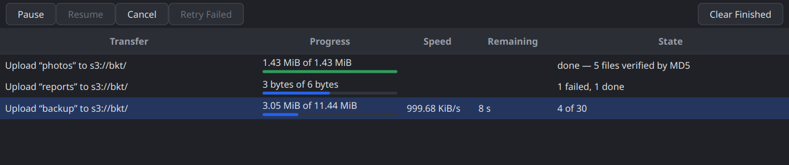
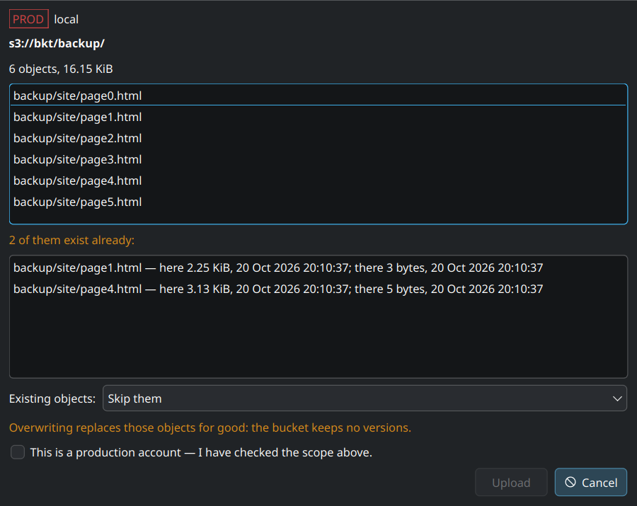

# Devlog 006 — M3: Transfer engine

**Date:** 2026-10-20

## What was built

Uploads and downloads of any size, verified and resumable — after a pause,
an application quit or a crash (PLAN.md §6 M3, §12.5, §13.3). Library
first, then the app; twelve stages on `main`, each a commit with ctest
green:

| Stage | Commit | What |
|---|---|---|
| 1 | `7cfa0f6` | `Session`: `FileBody` (a file range as request body, re-read per attempt), `getObjectToFile` (whole / range / part into a file at an offset), `ProgressCallback`, `throttled`, `SessionOptions::transferLanes`, `ErrorCategory::LocalIo` |
| 2 | `c3a8e4c` | Multipart on `Session` (create, part, complete, abort, list parts / uploads, part copy), `headObject` with a part number, `If-None-Match`, `Feature::MultipartUpload`; `testing::FakeObjectStore`; Docker + Hetzner ITs |
| 3 | `73293bf` | `qbucket::s3_transfer`: `planParts`, `hashRange`, multipart ETag helpers, `AdaptiveConcurrency` (AIMD), `ResumeStore` + `JsonFileResumeStore` |
| 4 | `7346576` | `transfer::Uploader`, `examples/s3cp`, `test_transfer_crash` (SIGKILL mid-upload, resume) |
| 5 | `2af4e32` | `transfer::Downloader` (`.qbpart`, ranges along the part layout, verification, atomic rename, mtime) |
| 6 | `90c57b3` | `transfer::Copier` (UploadPartCopy, any size) |
| 7 | `7530f1a` | App: `TransferService` (a limiter per account, the resume store), pausable / non-mutating jobs, Settings → Transfers |
| 8 | `346702b` | `UploadJob` (`LocalScanner`, conflict merge against the target listing, skip / overwrite / keep both) |
| 9 | `6d31d20` | `DownloadJob` (`LocalPathMapper`: never outside the target, names the system can't hold replaced, collisions) |
| 10 | `8fa8e91` | `TransferModel` + `TransferPanel`; `TransferJobStore`: suspend on quit, resume or discard at the next start |
| 11 | `9d29371` | Drag & drop in, Tools → Incomplete Uploads (`AbortUploadsJob`), rename above 5 GiB via `Copier` |
| 12 | this entry | Kill / resume proofs (Docker, Hetzner), `serverWorkTimeoutMs`, `bench/bench_transfer`, docs |

## Decisions and why

- **The library streams; the transfer engine only uses the public
  `Session`.** A `FileBody` names a file range plus its Content-MD5; the
  worker opens a `FileRangeDevice` per attempt (a retry re-reads from the
  range start) and QNAM sends it with `DoNotBufferUploadDataAttribute`.
  Downloads write chunk by chunk at a file offset with an incremental MD5 —
  no part is ever held in memory. `Uploader` / `Downloader` / `Copier` in
  `qbucket::s3_transfer` are built on `Session` alone, so they are
  testable against `FakeObjectStore` and reusable.
- **Transfer lanes instead of one QNAM.** `SessionOptions::transferLanes`
  (app: 4) starts worker threads with their own `S3Client` + QNAM on
  demand; file bodies and file downloads go to the least busy lane,
  browsing stays on its own thread. Clock offset (a shared atomic) and
  capabilities reach every lane, also lanes started later.
- **`UNSIGNED-PAYLOAD` over TLS, the signed SHA-256 over plain HTTP.**
  Integrity of a streamed body comes from Content-MD5 (the server rejects a
  changed body with BadDigest); the hash is computed beforehand on a thread
  pool, one part ahead of the uploads. `Session::requiresPayloadHash()`
  tells when the SHA-256 is needed too.
- **One AIMD limit per account.** Every upload, download and copy of an
  account draws its parts from one `AdaptiveConcurrency`: +1 after 8
  unthrottled parts, half on SlowDown / 503 — once per window, so the
  throttles of requests that were in flight together don't halve it to
  one. Ceiling from Settings (default 16).
- **Resume is two layers.** Per file, the library records every finished
  part (`<id>.json` + appended `<id>.parts`; a torn last line after a
  crash is ignored, the next line starts fresh). On resume ListParts decides
  what the server really has; a part the record missed (the process died
  in between) is adopted when the local bytes hash to its ETag; an upload
  that vanished starts over; a changed source fails. Per job, the app keeps
  the plan and the ordinals of the items done (`TransferJobStore`), so a
  folder upload of a million files continues with the remaining ones.
  Quitting *suspends* running transfers (nothing aborted, records kept);
  after a crash the same records are there, and the window asks: resume,
  discard, later.
- **A lost Complete answer is resolved, never retried blindly.** HEAD: if
  the object has the expected MD5-of-MD5s, it landed; if the upload still
  exists (ListParts), Complete is tried once more; otherwise the outcome is
  reported as unknown and the upload kept for later.
- **Verification is reported honestly.** Uploads: single-part ETag ==
  MD5, multipart ETag == MD5 of the part MD5s; anything else (SSE-C / KMS)
  counts as size-verified only. Downloads: ranges follow the object's own
  part layout (HEAD `?partNumber=1`), so the MD5-of-MD5s can be checked;
  single-part objects are hashed as a whole; otherwise "size verified
  only". A mismatch fails and keeps the `.qbpart` for inspection.
- **No overwrite unasked — and no trust in `If-None-Match` where it isn't
  honoured.** Hetzner and Garage ignore `If-None-Match: *` (the PUT
  overwrote in `it_s3_backend conditionalPutBehaviour`), so their profiles
  know `ConditionalWrites` as Unsupported and the library refuses the
  header locally. `UploadJob` then checks with HEAD right before each write
  (a small race window remains, documented); Ceph and VersityGW honour the
  header.
- **Conflicts come from the plan, not from per-file lookups.** The local
  walk visits siblings in S3 key order (UTF-8 bytes, a folder with its
  "/"), so its records come out sorted and can be merge-joined with a
  listing of each uploaded folder's prefix — one listing instead of a
  million HEADs, memory bounded. The preview shows both sides' size and
  date for each conflict and the policy: skip, overwrite (makes the job
  destructive: fresh capabilities, production tick), keep both
  ("name (1).ext").
- **Downloads never write outside the chosen folder.** `LocalPathMapper`
  refuses keys with "." / ".." segments (Qt couldn't request them either),
  turns empty segments and characters the system forbids into "_",
  prefixes Windows device names, refuses segments over 255 bytes; the
  worker pass also finds collisions inside the download ("a" and "a/b",
  case-insensitive twins on Windows). Downloads only read: they run on
  read-only accounts (`Job::isMutating() == false`).
- **Drops always ask.** Files dragged onto the list, a folder row or a
  sidebar bucket open the preview — a drop is easily an accident. Only one
  file chosen in the file dialog on a non-production account without a
  conflict starts straight away.
- **Renames above 5 GiB copy in parts.** `RenameJob` uses `Copier`
  (UploadPartCopy, every part with the source's ETag as
  `copy-source-if-match`); the M2 limit is gone.
- **Deviation from PLAN.md M3:** the Flatpak portal check (drag & drop
  paths through the document portal, file chooser) moves to M7 / M8;
  everything was verified natively.

## Measurements

All with release builds; Docker backends on the same machine (NVMe, ext4).

**Kill / resume, `s3cp`** (scratchpad script: generate, `kill -9` at a
fraction of the progress lines, `resume`, MD5 of source and copy):

| Run | Kill | Resume | Result |
|---|---|---|---|
| 10 GiB upload → Garage | at 46 % (587 / 1 280 parts) after 19 s | 5.8 GB more in 24.9 s (≈ 233 MB/s) | `md5-verified`, ETag `…-1280` |
| 10 GiB download ← Garage | at 41 % after 8 s | 6.4 GB more in 12.1 s, incl. the whole-object check | `md5-verified`, MD5 of the copy == source |
| 50 GiB upload → VersityGW, twice | at 45 % (2 885 / 6 400 parts) | every part sent; Complete failed | see Pitfalls — a VersityGW-on-ext4 limit |

The plan said 50 GB; after the VersityGW runs the proof was made with
10 GiB (agreed with the user) — part count and resume logic don't change
with the size, and the one size effect that mattered (a Complete that takes
minutes) now has its own test. The resumed run continued from the parts
the server listed (that none is sent twice is checked by
`test_transfer_crash`); no multipart upload stayed open, the objects were
removed afterwards. "More" is the remainder by the part layout; `s3cp` now
reports a resumed run's rate over the bytes of that run only.

**`bench/bench_transfer`** (release, FakeObjectStore in discard mode, GUI
stall = longest gap of a 1 ms GUI timer):

| Metric | Value | Budget |
|---|---|---|
| Plan a folder upload of 1 000 000 files: GUI stall | 4 ms | < 50 ms |
| … time / memory growth | 5.4 s / 5.2 MB | — |
| 2 GiB upload: GUI stall / throughput | 3 ms / 279 MB/s | < 50 ms |
| 4 uploads + listing 100 000 objects: GUI stall | 6 ms | < 50 ms |
| 4 × 256 MiB: aggregate throughput | 264 MB/s | — |

Throughput against the fake server is bounded by hashing (MD5 on the I/O
pool, one part ahead) and loopback HTTP in one process; against VersityGW
`s3cp` moved 2 GiB at 247 MiB/s, 5 GiB at 220 MiB/s.

## Hetzner (nbg1)

- `it_s3_backend` on `qbucket-it-test`: 17 passed, 3 skipped (second
  bucket / restricted user not configured, repeated slashes covered
  elsewhere); on `qbucket-it-lock` (`QBUCKET_IT_BACKEND=hetzner-lock`) the
  same; `crossBucketCopy` with the second bucket passes. New in M3:
  `multipartRoundTrip`, `multipartCopy`,
  `multipartRequestsLeaveAnExistingObjectAlone` (the proxy keeps the
  `?uploadId` / `?partNumber` query — UploadPart and Abort on an existing
  key leave it intact), `conditionalPutBehaviour` (**If-None-Match is
  ignored** — the PUT overwrites; profile: ConditionalWrites Unsupported).
  `UNSIGNED-PAYLOAD` and HEAD / GET `?partNumber=` work.
- `it_operations`: 7 / 7, including `uploadAFolder` (70 MiB, one file
  multipart) and `downloadTheUploadBack` (MD5-verified).
- **2 GiB kill / resume** through `s3cp` under `it/m3-<ts>/`: upload killed
  at 45 % (105 / 256 parts), resumed, `md5-verified …-256`; download killed
  at 40 %, resumed, MD5 identical; no multipart upload left open; the object
  and its version deleted (HEAD 404 afterwards).
- **Throughput:** upload 2.2 MiB/s — a single `curl` PUT of 64 MiB from the
  same machine reached 1.99 MiB/s, so the uplink is the limit and the
  ≥ 80 % target is met. Download 17.3 MiB/s; the downlink was not measured
  separately.

## Pitfalls

- **Assembling 50 GiB takes the server minutes, in silence.** The first
  50 GiB run (VersityGW) uploaded every part after the kill, then
  CompleteMultipartUpload ran into the 120 s transfer timeout: the server
  concatenates the 6 400 parts before it sends the first byte of its
  answer. The resolution did the right thing — HEAD found nothing, the
  upload was still open, one more Complete, then "outcome unknown" with the
  parts kept on the server. Complete, CopyObject and UploadPartCopy now get
  `SessionOptions::serverWorkTimeoutMs` (15 min); test
  `slowCompleteGetsTheServerWorkTimeout`. In the second run the Complete
  waited 6 minutes without a timeout — and then failed anyway:
- **VersityGW on ext4 can't complete uploads of more than ~640 parts.** Its
  POSIX backend stores per-part metadata of the finished object in an
  extended attribute; ext4 without `ea_inode` allows about 4 KB of xattrs per
  inode and answers ENOSPC, which VersityGW returns as 500 InternalError
  ("set object multipart metadata: No space left on device" in its log) —
  with 200 GB free. 625 parts worked, 1 280 didn't, killed or not. A
  limitation of the test backend on this file system (XFS / `ea_inode`
  would do), not of the client — which reported it honestly each time. The
  big kill / resume proof moved to Garage, which keeps blocks in plain
  files; Ceph's demo cluster has only 10 GiB of OSD space.
- **A range still under way re-created the partial file its download had
  just removed.** The sink opened `.qbpart` with `ReadWrite`, which creates
  a missing file; a range whose start was already queued on the worker
  when the download failed brought the deleted file back (one flaky test
  in 25). Downloads now prepare the file and open it with `ExistingOnly`
  (`GetObjectToFileParams::createFile = false`); removal waits until the
  requests are stopped and retries (Windows refuses to delete an open file).
- **A torn part line swallowed the next record.** After a kill the parts
  file can end in half a line; the first append after the restart was
  glued to it and lost. `JsonFileResumeStore::addPart` starts a fresh line
  when the file doesn't end with one (found by its own test).
- **Requests of a killed run arrive late.** The test server runs in the
  test's own thread, so requests the first run had on the wire are only
  counted when the next run spins the event loop — the "nothing sent
  twice" counts first let a short wait pass.
- **`QSignalSpy::wait()` waits for the next emission**, and jobs are
  deleted after they finish: a check after a `QTRY_*` loop must accept a
  signal that already came, and must not touch the job in its message.
- **QtTest's crash handler can deadlock** (it forks after an abort while
  another thread holds the malloc lock); `QTEST_DISABLE_STACK_DUMP=1`
  showed the real failure — a missing folder for the download plan.
- **The progress delegate painted its text twice**:
  `QStyledItemDelegate::paint` re-initialises the option; the background is
  drawn with the style directly now.

## Open points

- Flatpak: drag & drop from the host through the document portal, the file
  chooser portal (M7 / M8).
- KeepBoth after a crash: an item uploaded under "name (1)" but not yet
  marked done is uploaded again as "name (2)" on resume.
- Items that failed in an earlier session are not retried automatically
  by a resumed job (they are reported in that session's log).
- Per-account "verify uploads" switch (PLAN §12.5) — Content-MD5 is always
  on for now.
- fsn1 / hel1 and SSE-C still unverified (from M2).
- VersityGW's Docker volume on XFS (or ext4 with `ea_inode`), so ITs with
  thousands of parts can run there too; a 50 GiB run against a backend
  without that limit, or against Hetzner on a faster uplink.
