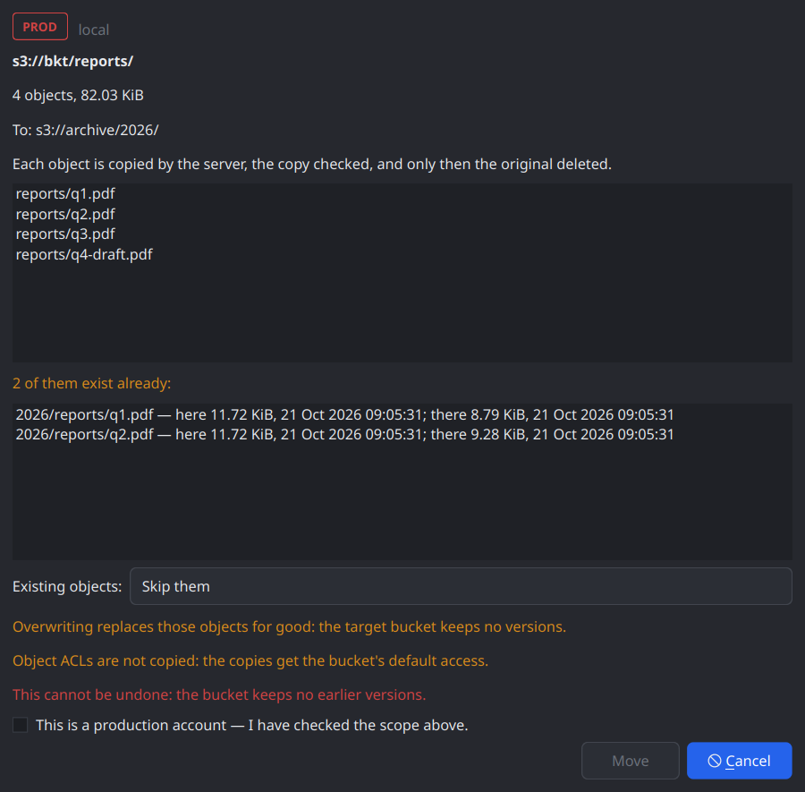
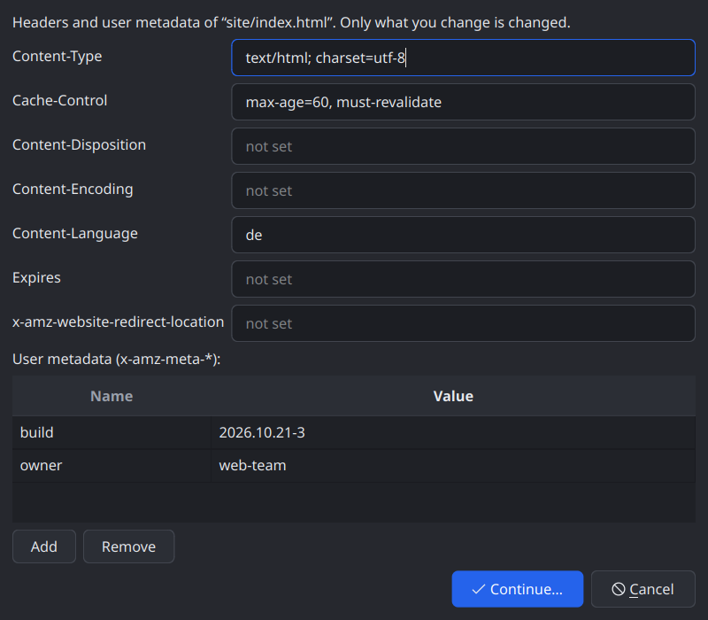
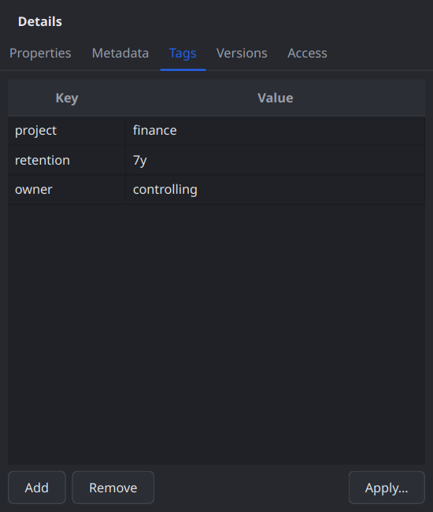
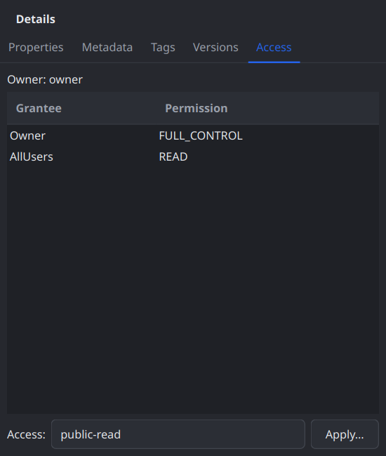

# Devlog 007 — M4: Object operations

**Date:** 2026-10-21

## What was built

Copy and move (also between buckets), cut / copy / paste and drag & drop
inside QBucket, editing headers / metadata / storage class in place, an
object's tags and canned ACL, presigned links, and folder sizes (PLAN.md
§6 M4, §12.3). Library first, then the app; fourteen commits on `main`, each
with ctest green:

| Stage | Commit | What |
|---|---|---|
| L1 | `668d136` | `ObjectHeaders`, the full headers in `ObjectMeta`; `CopyObjectParams::metadataDirective` (REPLACE), SSE, canned ACL; copy onto itself when it changes something; `ProviderProfile::storageClasses()` |
| L2 | `d7a5e28` | Object tags and ACLs on `Session`; write-only features `ObjectTaggingWrite` / `ObjectAclWrite`; the "answered like an upload" guard; canary and victim ITs |
| L2b | `31faf62` | Hetzner: tag and ACL writes confirmed by writing, profile updated |
| L3 | `7d9d182` | `Copier` with replaced headers, canned ACL, SSE (edits above 5 GiB) |
| L4 | `c376a90` | Presign checks `Feature::Presign`; "download as" links |
| fix | `cb7df64` | A resumed upload waited for nothing: parts were pumped before ListParts answered (see Pitfalls) |
| A1 | `90b9739` | The gate checks every bucket of a job (`Job::buckets()`) |
| A2 | `d998656` | `ObjectCopyRunner` out of `RenameJob` |
| A3 | `7fa6707` | `CopyJob`: copy / move, also between buckets |
| A4 | `cdc26e5` | Clipboard (Ctrl+C / X / V), internal drag & drop |
| A5 | `565a986` | `EditObjectsJob`, `EditMetadataDialog`, Change Storage Class |
| A6 | `05185c1` | `ObjectPropertyJob`; Tags and Access tabs |
| A7 | `7adc981` | `PresignService`, `PresignDialog` |
| A8 | `c738d38` | `FolderSizeTask`, "Calculate Size" |
| A9 | this entry | Benchmarks, Hetzner run, screenshots, docs |

## Decisions and why

- **A read probe never unlocks a write — now also for objects.** `GET
  ?tagging` answering 200 says nothing about `PUT ?tagging`: Hetzner's proxy
  once executed `DELETE /?encryption` as DeleteBucket, and a dropped
  `?tagging` on an object PUT would be a PutObject that replaces the object
  with the XML. So tag and ACL writes have their own write-only features
  (`object.tagging-write`, `object.acl-write`), set only by a profile — and
  Hetzner's was set only after two ITs on guarded buckets: the *canary*
  (writes on a missing key must fail and create nothing) and the *victim*
  (an existing object keeps content, ETag and size through tag and ACL
  writes). `featuresFor()` lists the operation's own feature first; a 501
  teaches only that one. No `DeleteObjectTagging` is ever sent (an empty
  tag set removes them). And a tag / ACL write answered with an ETag is a
  Protocol error — the server stored it as an upload.
- **An edit is a copy onto itself with REPLACE, merged into a fresh
  snapshot.** REPLACE keeps exactly what is sent. So each object's HEAD,
  tags and ACL are read right before (not what a dialog showed), the change
  merged in, the copy guarded by `copy-source-if-match`, the canned ACL and
  SSE-S3 sent along — then everything is read back and compared (once more
  after a moment: Hetzner's reads lag). Objects whose state a copy can't
  carry are skipped with the reason: SSE-C, KMS, retention / legal hold on
  the version, archive classes, ACLs for particular accounts, tags or a
  public ACL where writing them isn't confirmed, non-ASCII headers. Tags
  are written back with `PutObjectTagging` after the copy (see Pitfalls for
  why not with the copy).
- **Copy between accounts is deferred** (the user's call): it streams
  through this machine and deserves the transfer engine's resume. Paste and
  drops across accounts are refused with that reason.
- **Moves never delete an unverified copy.** `ObjectCopyRunner` (out of
  `RenameJob`) copies — CopyObject or a multipart copy, both guarded by the
  planned ETag, the storage class carried — checks size and ETag, and only
  then deletes the source. `CopyJob` finds conflicts by merging the target
  prefix's listing with the sorted sources (memory bounded), looks each
  target up again right before writing, and refuses a folder into itself
  and a move onto its own place; a copy onto its own place makes "name (1)".
- **The gate checks every bucket a job touches** (`Job::buckets()`): a copy
  into another bucket is checked, probed fresh and refreshed there too.
- **Shortcuts like a file manager.** Ctrl+C / X / V copy, cut and paste
  objects; the clipboard carries `application/x-qbucket-objects` (keys only;
  the job lists afresh) plus the `s3://` URIs as text. Copy Key moved to
  Ctrl+Shift+C, Copy S3 URI to Ctrl+Alt+C. Drags copy, Shift moves; the
  preview always opens; a drop back where the objects are is ignored (a
  slip of the mouse).
- **Storage classes come from the profile.** Hetzner and Garage have one
  (the action is disabled with the reason), AWS seven; unknown servers get
  an editable list — the server refuses what it doesn't have. A class
  change takes the same REPLACE path as an edit (one tested way).
- **Presigning is no Job, but its policy isn't in the UI.** `PresignService`:
  GET links on read-only accounts, PUT links only where the account writes,
  the provider's expiry cap, warnings for PUT and for links valid longer
  than a day, PUT links journaled (never the URL).
- **Folder size is a task, not a job** — it changes nothing; it runs only
  on request, can be cancelled, and an error is never "0 objects".
- **Deviations from PLAN.md M4:** cross-account copy → later; the grant
  table is read-only (no grant editor, the user's call); the Versions tab
  stays a placeholder until M5.

## Measurements

`bench/bench_transfer` (release, FakeObjectStore, GUI stall = longest gap
of a 1 ms GUI timer):

| Metric | Value | Budget |
|---|---|---|
| Plan a copy of a 100 000-object folder (both listings merged): GUI stall / time | 1 ms / 0.8 s | < 50 ms |
| Count a folder of 1 000 000 objects: GUI stall / time / memory growth | 0 ms / 6.4 s / 0 MB | < 50 ms |
| (M3 phases, unchanged) plan 1 000 000 files / upload / 4 uploads + listing | 12 / 7 / 3 ms | < 50 ms |

## Hetzner (nbg1)

- `it_s3_backend` on `qbucket-it-test` (with the second bucket) 26 passed,
  2 skipped; on `qbucket-it-lock` 25 passed, 3 skipped. New in M4:
  `copyInPlaceReplacesMetadata`, `copyInPlaceClassChange` (info),
  the canary and the victim, `copyKeepsTags`, `copyResetsAclUnlessCanned`,
  `multipartCopyInPlaceWithReplace`, `presignedPut` and a named
  `presignedGet`.
- `it_operations` 10 / 10 on both buckets: copy / move a folder (also into
  `qbucket-it-lock`), edits in place — a tagged `public-read` object keeps
  both through an edit (its tags are dropped by the copy and written back) —
  tags and ACL through their jobs.
- `it_browser` with the read-only account: cut, paste, edit, class change
  disabled; copy and links offered.
- Guard objects checked before and after every run.

Docker: `ctest -L docker` 6 / 6 (Ceph, VersityGW, Garage); generic profiles
refuse tag and ACL writes (not confirmed), and edits leave tagged objects
alone there.

 

## Pitfalls

- **RGW drops an object's tags on a copy onto itself with REPLACE** —
  Ceph and Hetzner, also with an explicit `x-amz-tagging-directive: COPY`
  (`copyKeepsTags`). A metadata edit there would silently lose tags.
- **Hetzner leaves tags sent with the copy unreadable.** With
  `x-amz-tagging-directive: REPLACE` + `x-amz-tagging` the copy succeeds,
  then `GET ?tagging` answers **200 with an empty body** and HEAD reports no
  tags. Docker-Ceph doesn't do that. `PutObjectTagging` after the copy
  restores them — that's what edits do; `CopyObjectParams::tags` documents
  the trap.
- **VersityGW keeps standard headers a REPLACE leaves out** (Cache-Control,
  Content-Disposition, …; user metadata is replaced). Removing a header
  "succeeds" and changes nothing — the edit's read-back reports it.
- **Garage accepts any copy onto itself and ignores the storage class** —
  a class change would look done. Its profile lists STANDARD only, and the
  read-back would catch it anyway.
- **A resumed upload sent its parts twice and once tried an incomplete
  Complete.** `adoptRecord` set the upload id before ListParts answered; a
  slot freed in the account's shared limiter (another file of the same job)
  pumped the parts meanwhile, `matchParts` then counted the recorded ones a
  second time, and Complete went out a part short — the client refused it,
  but `test_upload_job` failed 4 times in 40 under load. The pump now waits
  for the match; a deterministic test reproduces it. (M3 bug, found here.)
- **FakeObjectStore turned PUT `?tagging` into an upload** — any unknown
  subresource fell through to PutObject. Now 501, and a switch simulates
  the dropping proxy on purpose.
- **A test binary started by hand uses the real desktop.** On KDE / Wayland
  the clipboard of an unfocused test window never reaches the compositor
  and Klipper hands back its own content — the cut / paste test "failed"
  only outside ctest. Run test binaries with `QT_QPA_PLATFORM=offscreen`
  like ctest does.
- **"Cu&t" and "Download &To"** shared the T in the Edit menu; Cut has no
  mnemonic in English now (C, u and t are all taken).

## Open points

- Copy / move between accounts (download + upload through the transfer
  queue).
- A grant editor; SSE-KMS objects in edits.
- Tags for many objects at once (single object only now).
- `Feature::MetadataReplace` if a backend turns out to mishandle REPLACE
  harmfully (VersityGW only keeps headers — reported, not harmful).
- Versions (M5): the Versions tab, version-aware copies.
