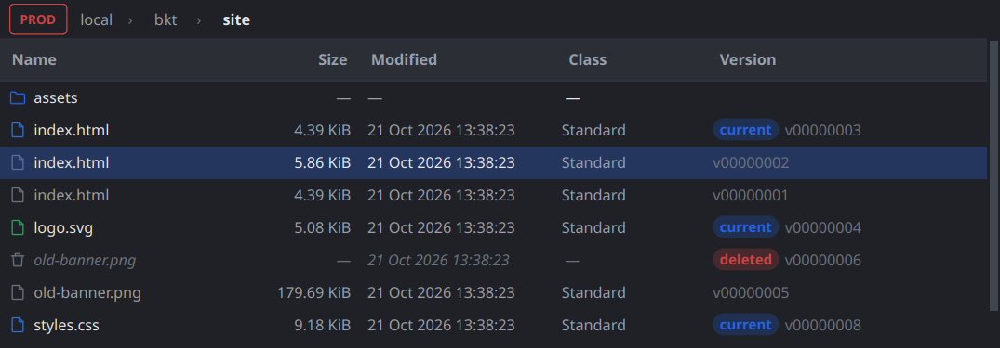
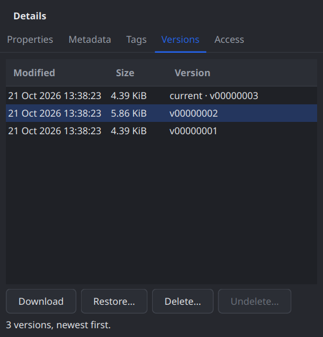
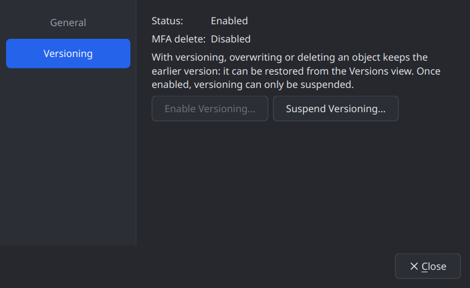
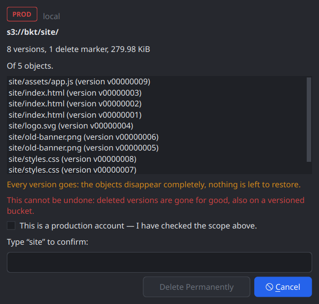

# Devlog 008 — M5: Versioning

**Date:** 2026-10-21

## What was built

Object versions end to end (PLAN.md §6 M5, §12.3 "versioned buckets",
§13.5 "versioning-aware confirmations, separate permanent-delete flow"):
a Versions view, a Versions tab, downloading / linking / restoring a
version, deleting versions for good, bringing deleted objects back, and the
bucket's versioning switch in a first Bucket Properties dialog. Library
first, then the app; one commit per stage on `main`, each with ctest green:

| Stage | Commit | What |
|---|---|---|
| L1 | `59d586d` | `ListObjectVersions` (types, parser, `Session`, `ListObjectVersionsPager`), delete markers on `Error`, a versioned `FakeObjectStore` |
| L2 | `d77c77f` | `Get/PutBucketVersioning`, write-only `Feature::BucketVersioningWrite`, the CreateBucket guard, version ITs, canary, toggle |
| fix | `b84e6bc` | The ITs clean up every version — and finally clean up at all on Hetzner (see Pitfalls) |
| L2b | `7eb3c43` | Hetzner: versioning writes confirmed on a guarded scratch bucket |
| A1 | `c35903f` | `InPlaceCopy` out of `EditObjectsJob`; `versioningOf()`; batch deletes journal their markers |
| A2 | `7247380` | The Versions view (`ObjectTableModel::Mode::Versions`) |
| A3 | `5f00154` | The Versions tab; a version row shows that version |
| fix | `f1a96fb` | Versions of a page in S3's order, also from VersityGW |
| A4 | `bd825a4` | `DeleteVersionsJob` (versions / everything / undelete), `RestoreVersionsJob`, version downloads |
| A5 | `5f5b188` | `SetBucketVersioningJob`, `BucketPropertiesDialog` |
| A6 | `a58c24e` | Menus, Shift+Del, the details' buttons, links to a version, `UndeleteDialog` |
| perf | `d75ee10` | Sorting a million rows: no string per row on the GUI thread; bench phase |
| fix | `5854be3` | The permanent-delete preview counts versions and says why it is permanent |
| A7 | this entry | Benchmarks, Hetzner and Docker runs, screenshots, docs |

Plus `0c00f57` / `35999dd`: `tools/check-msvc-shadow.sh` (see Pitfalls).

## Decisions and why

- **A read probe never unlocks a write — also for a bucket's
  versioning.** A proxy that drops `?versioning` turns the PUT into
  CreateBucket. So `PUT ?versioning` needs the write-only feature
  `bucket.versioning-write`, set by a profile only after two ITs: the
  *canary* (PUT `?versioning` on a bucket name that doesn't exist must fail
  and create nothing) and *toggleVersioning* on a scratch bucket holding a
  guard object (Enabled → Suspended → Enabled, read back each time). An
  answer that looks like CreateBucket (a `Location` header, 409
  `BucketAlreadyOwnedByYou`) is a Protocol error. Hetzner passed both on
  the new `qbucket-it-versioning`.
- **One model, a third mode.** The Versions view is `ObjectTableModel` in
  `Mode::Versions`, not the `VersionTableModel` PLAN.md named: one
  selection model, the same paging, filter and background sort, no model
  swap in the browser. A row carries an index into a version-id list (the
  row stays 48 bytes — it fits the padding); the view is never served from
  the listing cache. Sorting by name keeps a key's versions together,
  newest first, in both directions; other columns sort rows on their own.
- **Plans come from a fresh listing, and "is a delete marker" only from the
  listing.** Every version job walks `ListObjectVersions` (`VersionWalk`:
  a prefix flat, or exactly one key) — never what the view showed. A
  selected version that is gone is skipped with the reason. HEAD can't tell
  a marker on RGW (see Pitfalls), so removing a marker never relies on it.
- **Permanent is permanent — and always typed.** Deleting versions or
  everything of an object is `permanent`, and the preview always asks to
  type the name (also for a single version; the user's call), says how
  many versions and markers of how many objects, and warns when current
  versions are among them. MFA delete refuses it (QBucket sends no MFA
  codes); locked versions fail with the reason — no governance bypass
  (that comes with object lock in M6).
- **Undelete removes the markers over the newest version**, nothing more:
  a stack of markers goes, a key with markers only is left alone (removing
  them would bring nothing back), optionally only markers set after a
  moment. It deletes only marker versions confirmed by the listing.
- **Restoring takes the edit's path.** `InPlaceCopy` (moved out of
  `EditObjectsJob`) copies the version over the current one with REPLACE of
  exactly its headers, its class, canned ACL and SSE-S3, guarded by the
  version's ETag; the tags are written back (RGW drops them) and
  everything is read back. On a versioned bucket nothing is lost; where
  versioning is suspended the preview says the current version is
  overwritten.
- **The versioning switch lives in a Bucket Properties dialog** (the
  user's call): General and Versioning pages in the settings look; M6 adds
  policy, CORS, lifecycle as further pages. Suspending is shown as what it
  is: overwrites and deletes are permanent from then on.

 

## Measurements

`bench/bench_listing`, release build, `offscreen` (as in devlog 005), 1M
version rows = 250 000 keys with four entries each:

| Metric | Value | Budget |
|---|---|---|
| Longest GUI stall while paging the versions view (1M rows) | 14 ms | < 50 ms |
| Memory per 100k version rows | 14.3 MB | < 40 MB |
| Longest GUI stall sorting the versions view by name (1M rows) | 24 ms (was 52 ms) | < 50 ms |
| (M2 phases) paging 100k / sort / flat 1M / scroll step | 4 / 3 / 11 / 2 ms | 10 / 50 / 50 / 16 ms |

On `wayland` the paging stall of the 100k folder was 16 ms and memory
45.5 MB per 100k rows — real window buffers and painting. Budgets are
checked on `offscreen`, as before; the numbers are recorded side by side.

## Hetzner (nbg1)

- Canary and `toggleVersioning` passed → `HetznerProfile` knows
  `BucketVersioningWrite` as Supported. `qbucket-it-versioning` (created
  for it, guard object, versioning Enabled) is the scratch bucket for
  bucket-setting writes from now on.
- `it_s3_backend`: `qbucket-it-test` 32 passed, 2 skipped;
  `qbucket-it-lock` 30 passed, 4 skipped. New: listing in pages of two with
  the marker pair, delete markers, reading and copying a version, deleting
  versions one by one and in batches.
- `it_operations` 12 / 12 on both buckets — restore a version, delete a
  folder and undelete it, delete a version, purge a folder.
- `it_browser` (read-only account) 4 / 4: the Versions view lists, every
  version action is off.
- Guards checked before and after; the runs leave nothing under `it/`.

Docker: `ctest -L docker` 6 / 6 (Ceph and VersityGW with a local
`<bucket>-versions`, Garage refuses with the reason). Library under ASan +
UBSan + LSan 32 / 32; release build with `-Werror` 76 / 76.

## Pitfalls

- **RGW and VersityGW answer HEAD on a deleted key with a bare 404** — no
  `x-amz-delete-marker`. RGW also for the marker's own version id;
  VersityGW answers that one 405 with the header. A marker is only certain
  from `ListObjectVersions` (expectation keys `headReportsDeleteMarker`,
  `headOnMarkerVersionReportsDeleteMarker`).
- **RGW sends no version ids on CopyObject** — neither
  `x-amz-copy-source-version-id` nor the new `x-amz-version-id`
  (`copyReportsVersionIds`). Look the copy up.
- **VersityGW lists every delete marker of a page before every version.**
  A key's entries weren't together, "newest first" didn't hold, and an
  undelete took a deleted object for one with markers only. The parser now
  sorts each page by key (UTF-8), the current entry first, then newest
  first — stable, so S3's own order stays. VersityGW also creates no
  marker for a DELETE of a key that doesn't exist (harmless).
- **The ITs hadn't cleaned up on Hetzner since M1.** A test key with
  control characters makes the library refuse a whole DeleteObjects batch,
  and the batch error was ignored; versions and markers were never deleted
  either, and copies into the second bucket never. Now a refused batch is
  retried one by one, cleanup lists versions in every bucket a run touched,
  and `QBUCKET_IT_RUN` repeats an old run's prefix to clean up after it.
  This session's runs are gone; older ones (2026-10-20 / -21 morning) are
  still there.
- **A destructive version job is refused until the bucket is probed** —
  "listing object versions" is Unknown before, and Unknown never unlocks a
  destructive job. Right for the app (opening a bucket probes it); tests
  have to open the bucket first.
- **Sorting a million rows stalled the GUI for 52 ms**: the sort itself ran
  in the pool, but building the keys made a name string per row on the GUI
  thread. The key is now a shared copy of the object key; the sorter cuts
  the name.
- **The MSVC shadow check had silently not run.** Without a real check
  enabled clang-tidy refuses ("no checks enabled") and prints its usage — a
  grep over that finds nothing. `tools/check-msvc-shadow.sh` fails loudly
  when clang-tidy didn't run, and ignores what MSVC accepts (init-captures,
  lambda parameters named like a member).
- **The machine went down mid-run**: two builds at `-j20` side by side plus
  the 1M-version benchmark, 31 GB and no swap — most likely memory (the
  previous boot's kernel log wasn't kept). Heavy work runs one after the
  other now, at `-j12`. The reboot also emptied `/tmp`, clang-tidy with
  it — the scripts said so instead of passing.

## Open points

- Object lock in M6: governance bypass per operation, retention / legal
  hold editing; then "delete version" can offer it.
- MFA delete stays read-only (no MFA codes).
- Copying a version to another key or bucket ("copy as").
- Editing tags / ACL of an earlier version (read-only now).
- The older IT leftovers under `it/` on `qbucket-it-test` (38 run
  prefixes) and `qbucket-it-lock` (21) — removable with `QBUCKET_IT_RUN`,
  waiting for a decision (the M1 ones were meant to stay).
- Deviations from PLAN.md M5: no separate `VersionTableModel` (a mode of
  `ObjectTableModel`); the Versions tab lists at most 5000 versions of a
  key (the view lists all).
