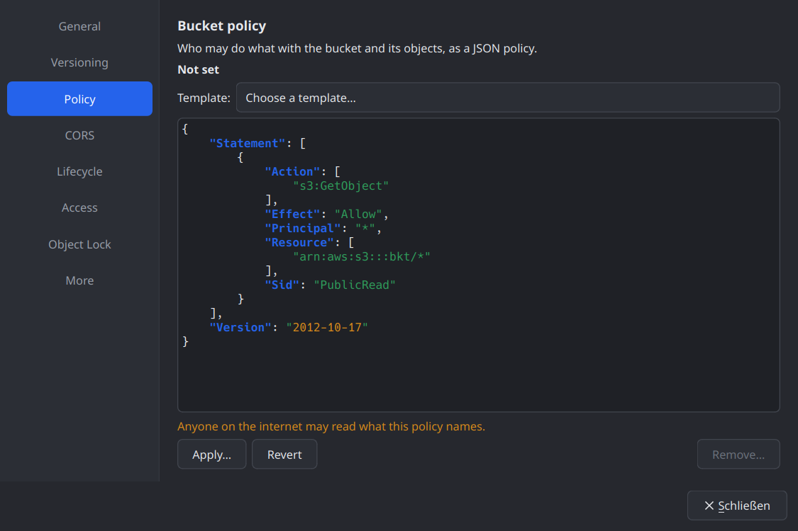
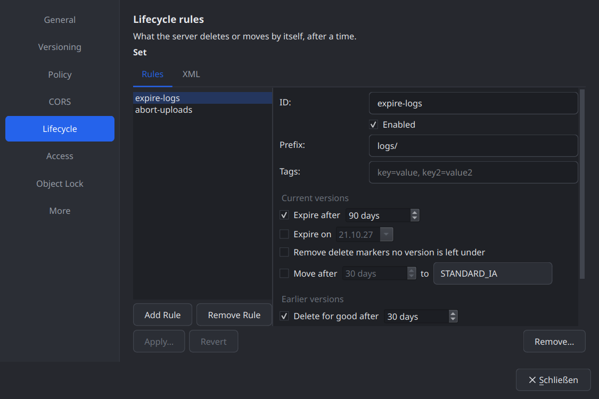
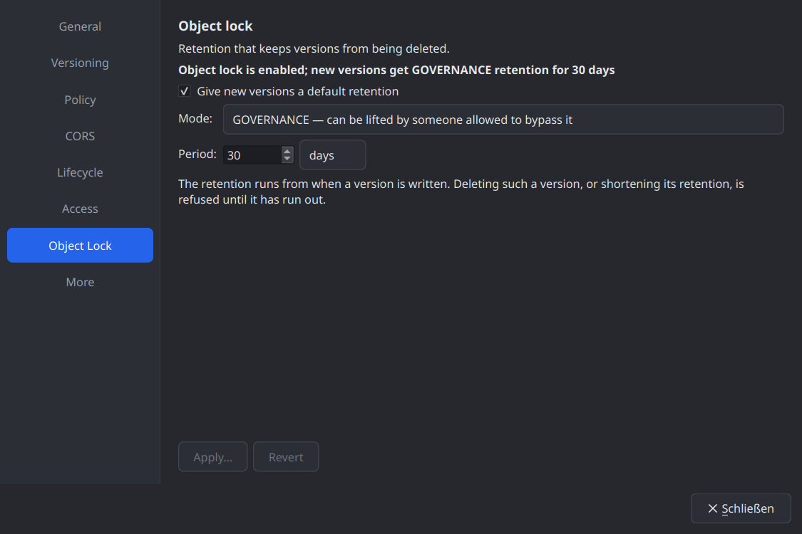
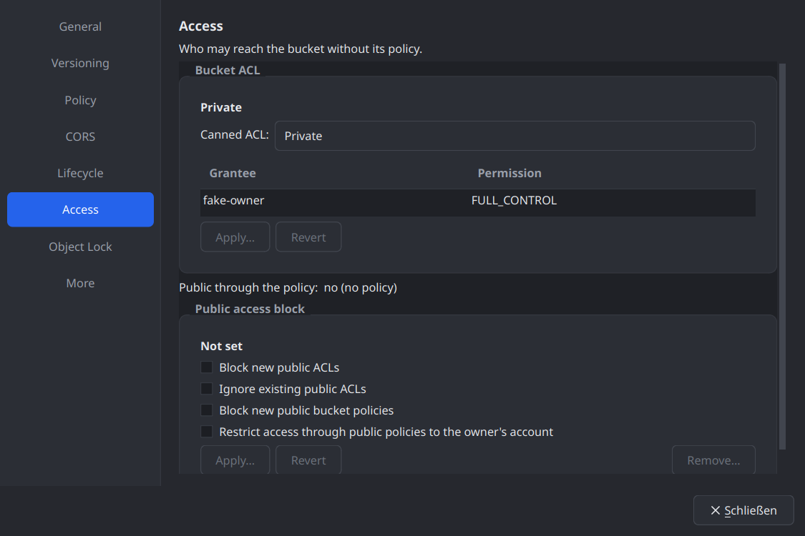
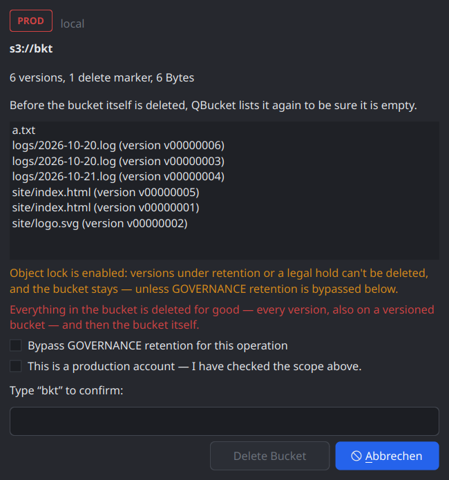

# Devlog 009 — M6: Bucket management

**Date:** 2026-10-21

## What was built

A bucket's configuration, object lock, and buckets themselves (PLAN.md §6
M6, §12.3 "object lock / legal hold", §13.5 "read-back verification of
every bucket config write, object-lock/governance safeguards"). The scope,
agreed before starting: editors for what Hetzner supports — policy, CORS,
lifecycle, access (ACL, policy status, public access block), object lock
(default retention, plus retention and legal hold per object, with the
governance bypass per operation) — and creating / deleting buckets; the
rest (bucket tags, website, logging, replication, encryption,
notifications, ownership controls) shown read-only. Library first, then
the app; one commit per stage on `main`, each with ctest green:

| Stage | Commit | What |
|---|---|---|
| L1+L2 | `0dd71d0` | `BucketConfig.h`: one transport for every configuration document, typed lossless-or-saying-so views, write guards, eight write-only features, retention / legal hold, the governance bypass, `CephProfile`, a `FakeObjectStore` with buckets, configurations and retention; ITs |
| L2b | `38fff35` | Hetzner: every configuration write confirmed on guarded scratch buckets; its DeleteBucket race found (see Pitfalls) |
| A1 | `76048f2` | `SetBucketConfigJob`, the bypass in the preview, `VersionPurger` out of `DeleteVersionsJob`, bucketless jobs in the gate |
| A2 | `345dee2` | Bucket Properties: Policy, CORS, Lifecycle, Access, Object Lock, More; size and creation date on General |
| A3 | `06996f0` | `CreateBucketJob`, `DeleteBucketJob`, New Bucket dialog, the Bucket menu, sidebar entries |
| A4 | `b3c4952` | The Lock tab (`ObjectLockJob`), the Bucket menu gated, it_operations / it_browser for M6 |
| A5 | this entry | Release / ASan / clang-tidy runs, screenshots, docs |

## Decisions and why

- **One configuration transport, typed views on top.** `Session::
  getBucketConfig / putBucketConfig / deleteBucketConfig` move raw
  documents for a `BucketConfig` kind; every kind still has its own
  `Operation` (journal, short-circuit, learning) and read / write
  features. Editors work on typed views (`CorsConfiguration`,
  `LifecycleConfiguration`, `ObjectLockConfiguration`,
  `PublicAccessBlockConfiguration`) whose parsers set `lossless = false`
  for anything they don't hold. **A form never drops what it can't show:**
  such a document is edited as text only, and the text is what is applied.
- **A read probe never unlocks a write — per kind.** Eight write-only
  features (`BucketPolicyWrite`, `CorsWrite`, `LifecycleWrite`,
  `ObjectLockWrite`, `BucketAclWrite`, `PublicAccessBlockWrite`,
  `RetentionWrite`, `LegalHoldWrite`), each for PUT and DELETE of its
  subresource, set by a profile only after a canary (PUT on a missing
  bucket creates nothing) and a write / read / remove run on a scratch
  bucket holding a guard object. AWS: all; Ceph (new `CephProfile`): all,
  from the Docker ITs; Garage: CORS and lifecycle; generic: none;
  Hetzner: all, after its run.
- **Answers that look like the wrong operation are errors.** A PUT
  answered like CreateBucket (a `Location` header, 409
  BucketAlreadyOwnedByYou) or a DELETE answered like DeleteBucket (409
  BucketNotEmpty) is a Protocol error — the way Hetzner's proxy once ran
  `DELETE ?encryption` as DeleteBucket. After every removal the job looks
  the bucket up: a proxy that deleted it instead would show there. Only a
  document of the kind's type leaves the machine (a JSON object, the
  expected XML root).
- **Every write is a job with a read-back.** `SetBucketConfigJob` reads the
  current document fresh, shows both in the preview with what the change
  does (public access, rules that delete, COMPLIANCE), and reads back until
  the server's copy is *equivalent* — JSON by value, the typed kinds by
  type, a lifecycle ID the server made up ignored.
- **The governance bypass is per operation and never preset.** The
  preview offers it only where object lock allows it; ticked, it adds its
  own red warning and the confirmation becomes "BYPASS <name>". It is
  journaled (`bypassGovernance`). COMPLIANCE is never bypassed — only
  extended — and a legal hold holds against the bypass.
- **A job on no bucket is gated by the account.** Creating a bucket has no
  bucket to probe; `checkJob_` checks the account (read-only) and the
  server's features instead of skipping the gate.
- **Deleting a bucket lists it empty twice.** `DeleteBucketJob` plans from a
  fresh walk (versions, delete markers, unfinished uploads; current objects
  where a server lists no versions), is always typed, deletes through the
  `VersionPurger` (shared with `DeleteVersionsJob`), aborts the uploads,
  then lists the bucket empty, waits `bucketEmptinessSettleSecs()` and lists
  it again before DeleteBucket — because of Hetzner (Pitfalls).
- **Object lock only at creation.** The Object Lock page changes the
  default retention; enabling object lock on an existing bucket is not
  offered (Hetzner: only at creation). New Bucket offers it, with
  versioning.
- **ACL: canned only.** The Access page sets a canned ACL and shows the
  grants read-only; grants a canned ACL can't express are replaced, and
  the preview says so. A grant editor is a deviation left for later.

 

## Hetzner (nbg1)

- `it_s3_backend` on `qbucket-it-test` 41 passed, 2 skipped (with the
  configuration writes on `qbucket-it-versioning`, object lock on the new
  `qbucket-it-lockcfg`, temporary buckets); on `qbucket-it-lock` 31 passed,
  12 skipped (the new tests need their scratch buckets).
- Canary: PUT `?policy`, `?cors`, `?lifecycle`, `?publicAccessBlock`,
  `?acl`, `?object-lock` on a missing bucket answer 404 and create nothing.
  On `qbucket-it-versioning` each was written, read back at once and
  removed, bucket and guard intact → the profile knows all eight write
  features as Supported.
- `it_operations` 15 / 15 on `qbucket-it-test` (settings, object lock and a
  bucket created, emptied and deleted through the jobs); 12 passed, 3
  skipped on `qbucket-it-lock`. `it_browser` (read-only account) 4 / 4.
- Guards checked before and after every run; no `qbucket-it-tmp-*` bucket
  and no configuration left on the scratch buckets.

Docker: `ctest -L docker` 6 / 6 — Ceph with every write, VersityGW
without lifecycle, public access block and ACL writes (refused as
expected), Garage with CORS and lifecycle only. Library under ASan +
UBSan + LSan 35 / 35; release build with `-Werror` 83 / 83; clang-tidy over
all 208 files clean.

## Pitfalls

- **Hetzner's DeleteBucket deletes a bucket that looked empty a moment
  ago — with the objects just written.** The proxy answers DeleteBucket
  itself and judges "empty" by statistics that lag about ten seconds.
  Measured with buckets created for it: one object written, DeleteBucket
  after 0, 3 and 7 s → **204, bucket and object gone**; after 12 s and later
  → 409 BucketNotEmpty from the proxy. An old bucket emptied, left for a
  minute and given one new object went the same way. The first
  `createFillEmptyAndDeleteBucket` run found it (a filled temporary bucket
  vanished on the "must fail" DeleteBucket). Consequences: the profile hook
  `bucketEmptinessSettleSecs()` (Hetzner: 20), `DeleteBucketJob` never
  relies on BucketNotEmpty, and `deleteBucketRightAfterAWrite` asserts the
  behaviour so a change shows up. The guard objects keep protecting the
  scratch buckets — they are days old; a bucket empty within the last ten
  seconds would not be protected by one.
- **A new bucket unknown to one gateway.** `qbucket-it-lockcfg`, an hour
  old, got 404 NoSuchBucket with an empty message from one RGW gateway on
  ~5 % of DELETEs (GETs fine, old buckets never). The proxy's own
  NoSuchBucket carries a message; the empty one is now retried
  (`HetznerProfile::mapError`).
- **A default retention reaches writes late on Hetzner.** Read back at
  once, applied to new versions only after 6 s in one run and 87 s in the
  next — and a removed one was still applied for a moment. The page and the
  preview say it may take minutes; the IT writes until a version shows it.
- **Garage's bucket ACL has no owner**, so no canned ACL can be read from
  it; its ACL writes answer 501. **RGW ignores `?ownershipControls`** and
  answers the bucket listing (the probe reads that as Unsupported; fixture
  in `tests/data/ceph`). VersityGW refuses ACL writes with
  AccessControlListNotSupported.
- **moc and raw string literals** — once more: a policy in an `R"(…)"`
  literal in `it_s3_backend.cpp` made AutoMoc fail ("missing ')'").
- `it_browser` against the local Ceph fails before M6 too (its first row
  there is a folder, so no object is shown); it never ran there. Hetzner
  passes.
- One full ctest run failed once and could not be reproduced in four
  more full runs, three Docker runs and six parallel runs of each new test
  binary; the failing test wasn't recorded (the next run overwrote ctest's
  log). Watch for it.

## Open points

- A grant editor for bucket ACLs (canned only now).
- Editors for bucket tags, website, logging, replication (shown only).
- Enabling object lock on an existing versioned bucket (AWS allows it;
  Hetzner doesn't).
- Retention / legal hold for a whole selection or folder (one version at a
  time now).
- Default encryption on Hetzner stays off (its proxy mishandles it);
  verify SSE-C by writing.
- `it_browser` on local backends (pick an object, not the first row).
- Deviations from PLAN.md M6: ACL canned only; tagging / logging /
  website / replication / encryption read-only; no separate
  `SessionController` (the capability controller and the profiles already
  merge as described).
