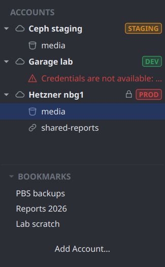
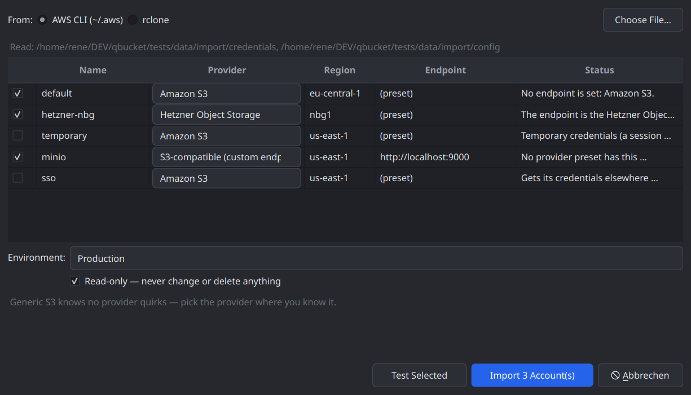
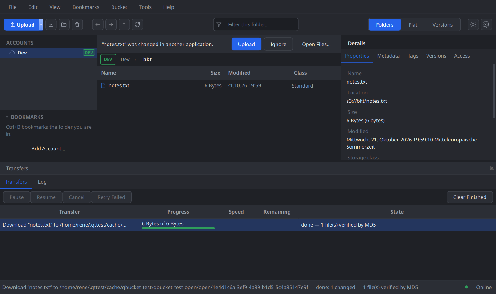
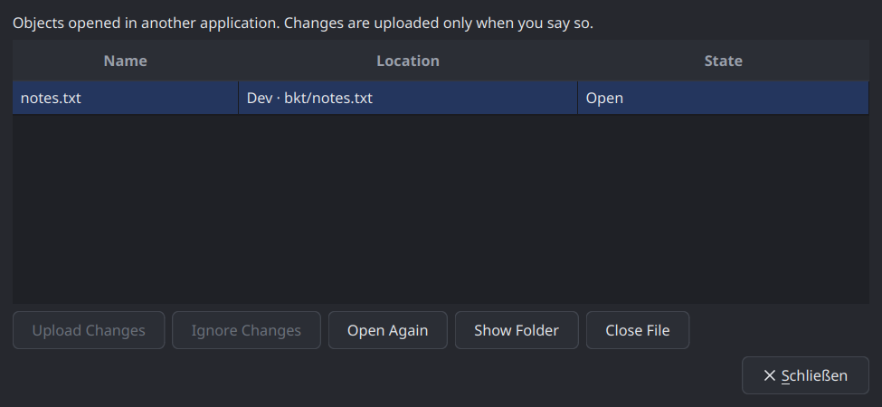

# Devlog 010 — M7: Drag out & platform polish

**Date:** 2026-10-21

## What was built

What was still missing for parity with S3 Browser (PLAN.md §6 M7): dragging
objects into a file manager, opening an object in its default application
and saving it back, bookmarks and recent locations, importing accounts from
the AWS CLI's files and rclone. Agreed before starting: the Windows drag as
real virtual files (Explorer pulls the bytes on the drop; checked by hand on
Windows), the provider of an imported account suggested by an exact match
with the profiles' preset endpoints, bookmarks in a menu and a sidebar
section. Library first, one commit per stage on `main`, each with ctest
green:

| Stage | Commit | What |
|---|---|---|
| L1 | `3c8b84b` | Ranged reads into memory (`GetObjectParams`), If-Match on PutObject / Complete and the write-only feature `ConditionalOverwrite`, every settable header on a PUT and an upload |
| L2 | `b117636` | `AwsConfigFiles` (the AWS CLI's profiles enumerated), `ProviderRegistry::matchEndpoint` |
| L2b | `d3bf529` | Hetzner: If-Match on writes unusable — the profile says Unsupported |
| A1 | `6ebaced` | Bookmarks and recent locations (`LocationStore`, Bookmarks menu, sidebar section; the sidebar follows the browser) |
| A2 | `73d685b` | Account import (`AccountImporter`, `RcloneConfigReader`, Import Accounts dialog) |
| A3 | `af23f07` | Open in the default application (`OpenFileService`), `ReplaceObjectJob`, the bar for changed files, Open Files |
| A4 | `7f160c7` | `src/platform/`; dragging out on Linux / Flatpak (`DragStaging`, `StagedDrag`, `StagingMimeData`) |
| A5 | `32df9d9` | Dragging into Windows Explorer (`VirtualFileReader`, `platform/win/`) |
| A6 | this entry | ITs on Docker and Hetzner, release / ASan / clang-tidy runs, screenshots, docs |

## Decisions and why

- **One place for platform code.** `src/platform/` (`qbucket_platform`,
  between controllers and ui) holds `ExternalDrag` — how objects leave the
  browser — with `VirtualFileDrag` on Windows and `StagedDrag` elsewhere.
  The browser only hands over its in-app drag data and the selection; the
  view (`ObjectTableView`) lets it take over the drag start when downloads
  are allowed (never in the versions view).
- **Windows: virtual files, never on the GUI thread.** `VirtualFileDataObject`
  answers `CFSTR_FILEDESCRIPTORW` (folders first, Windows-safe names through
  `LocalPathMapper`, case collisions refused, at most 10 000 entries) and a
  `RangeReaderStream` per `CFSTR_FILECONTENTS`. It is created on an MTA
  thread (the MTA kept alive with `CoIncrementMTAUsage`) and handed to
  `DoDragDrop` as a proxy, so the listing and every download run on COM
  threads and may block there. `IDataObjectAsyncCapability` lets Explorer
  copy on its own thread. The in-app formats go along under their MIME
  names, as Qt's drop targets look them up, so drops on QBucket's own
  folders and buckets work as before.
- **The data behind it is platform-neutral and tested on Linux.**
  `VirtualFileSource` is plain C++ (what the COM layer depends on);
  `VirtualFileReader` implements it over the account's Session: ranged GETs
  into memory with If-Match on the listing's ETag (a change while Explorer
  copies is an error, never a mix of two versions), two chunks of read-ahead
  on its own worker thread, callers blocking on a condition variable — and
  refused on the GUI thread. At the end the MD5 of what was handed out is
  compared with a single-part ETag (not under KMS / SSE-C) *before* the last
  bytes go out; everything else is "size verified", and the status bar says
  how many were MD5-checked.
- **Linux / Flatpak: staged copies, handed over at the drop.** A drop target
  needs files, and a drag can't wait for a download (XDS doesn't exist on
  Wayland; a `retrieveData` that waits would freeze the window). So the drag
  always offers `text/uri-list` (`StagingMimeData`) and fills it in only when
  a target asks at the drop — with the copies `DragStaging` downloaded into
  `CacheLocation/drag` if they are there. A small selection of objects (known
  sizes, ≤ 500, under the size limit) is staged as the drag starts; folders
  and large selections on "Prepare for Dragging Out" (the DownloadJob's
  preview asks above the limit). A drop that comes too early gets nothing,
  and the status bar says to drag again. This deviates from the plan's "wait
  while the button is held": in-app drags keep working unchanged, and nothing
  waits. In a Flatpak the cache is `~/.var/app/<id>/cache`, on the host's
  file system, so no new permission is needed.
- **Open = a transient download, an upload only when asked.**
  `OpenFileService` downloads into its own folder under the cache
  (`DownloadJob::Options::transient`: no resume record, a preview only above
  the size limit), hands the file to the desktop (`QDesktopServices`,
  injected) and watches file *and* folder (editors save by renaming). Only a
  content change (MD5, not a touch) is offered — the bar above the list:
  Upload / Ignore / Open Files. Versions and read-only accounts open
  write-protected. Quitting with unsent changes asks: keep them for the next
  session (`open-files.json`) or discard; nothing changed is deleted
  silently.
- **A replace keeps everything but the content.** `ReplaceObjectJob` reads a
  fresh `ObjectSnapshot`, refuses what `InPlaceCopy::cannotCarry` refuses
  (SSE-C / KMS, retention, legal hold, grants, unwritable tags), uploads with
  every header, class, SSE-S3 and canned ACL of the snapshot and writes the
  tags back with PutObjectTagging (RGW ignores `x-amz-tagging` there). A
  change or delete on the server since the file was opened is a conflict —
  skipped unless the preview says overwrite or keep both. The guard is
  If-Match where `ConditionalOverwrite` is confirmed, HEAD right before
  otherwise (a small window remains, as with uploads). Read back afterwards.
- **If-Match on writes is its own write-only feature.** A server that ignores
  it overwrites — exactly what Hetzner and Garage do with If-None-Match. So
  `ConditionalOverwrite` is Unsupported until an IT has seen a wrong ETag
  refused *and* the right one accepted, on PUT and Complete. A conditional
  PUT refused on its own retry (a lost answer) is resolved by HEAD in the
  Uploader.
- **Import: the provider by an exact preset match, confirmed by the user.**
  An imported Hetzner endpoint must become the Hetzner profile, or its
  safety quirks (DeleteBucket race, If-None-Match) are lost.
  `ProviderRegistry::matchEndpoint` compares scheme, host and port exactly
  with every profile's `endpointFor(region)`; the dialog shows it as a
  suggestion per row. The protocol core never asks it what it talks to, and
  `check-mutation-gate.sh` keeps its callers in `AccountImporter`. Session
  tokens, SSO, roles, `credential_process` and rclone's `env_auth` are
  listed as skipped with the reason; an encrypted rclone file says so. Each
  secret goes to the keychain first, then the account. In a sandbox the
  default files are invisible: "Choose File…" goes through the portal, no
  new permission.
- **Bookmarks and recents in their own small file.** `LocationStore`
  (`locations.json`): bookmarks in the user's order, the 20 most recent
  places, visits debounced (300 ms); a removed account or a deleted bucket
  takes its places along. The sidebar now follows the browser without
  echoing the selection back.

## Hetzner (nbg1) and Docker

- `it_s3_backend conditionalOverwrite`, run on its own first and then with
  the full suite: Hetzner refuses a wrong ETag on PutObject (412) — and the
  right one as well — and CompleteMultipartUpload overwrites despite a wrong
  If-Match. Ceph 19.2 in Docker does the same; with curl the cause showed:
  RGW compares If-Match with the *unquoted* ETag. Garage ignores If-Match
  entirely, VersityGW honours it. Profiles: AWS Supported; Hetzner, Ceph,
  Garage Unsupported (expectation key `conditionalOverwrite`).
- Full run on `qbucket-it-test` with the scratch buckets of devlog 009:
  `it_s3_backend` 42 passed, 2 skipped; `it_operations` 17 / 17 (new:
  `replaceAnEditedObject` — content replaced, headers, metadata and tags
  kept, a stale ETag skipped — and `virtualFileReaderReadsBack`, ranged
  If-Match reads with the MD5 check); `it_browser` 4 / 4. Guards checked
  before and after; only the four `qbucket-it-*` buckets afterwards.
- Docker `ctest -L docker` 6 / 6 (the new ITs on Ceph, VersityGW, Garage).
- ctest 98 / 98; release build with `-Werror` 92 / 92 (without Docker);
  library under ASan + UBSan + LSan 36 / 36; clang-tidy over all 233 files
  clean. The Windows sources were checked with llvm-mingw
  (`-fsyntax-only -Wshadow-all`); MSVC and `test_virtual_file_drag` run in
  the Windows CI.

 

## Pitfalls

- **RGW's If-Match on PUT wants the ETag without quotes** — the form every
  client sends (RFC 7232, and what S3 returns) is refused even when it
  matches, and Complete ignores the header. Not worked around: an unquoted
  If-Match that AWS might read differently is not a guard to rely on.
- **`QLatin1String("&Open Files…")`** never matched the action's text: the
  UTF-8 bytes of "…" were read as Latin-1. `QStringLiteral` for anything
  beyond ASCII.
- **`QMenu::clear()` leaves submenus alive** — the Bookmarks menu, rebuilt
  on `aboutToShow`, would have leaked a "Recent Locations" submenu each time.
- **lupdate only sees what the build system compiles**: the Windows drag's
  texts moved into the platform-neutral `ExternalDrag`.
- **A blocking reader in a test deadlocks against the fake server** on the
  same thread: the reader's callers run on a thread of their own (as
  Explorer's COM threads do), the test thread keeps serving.
- **A disabled `#primary` button looked enabled** (the accent background);
  the stylesheet has a `:disabled` rule for it now.
- A screenshot test that doesn't apply the theme shows Fusion's defaults —
  `test_main_window_open` applies Dark now.

## Checked by hand — and what is still to check

Not done here (no interactive mouse on this machine; no Windows):

- **Windows Explorer** (the user, with the Windows CI build): a file, several
  files and a folder dragged out of QBucket onto a folder and the desktop; a
  large file (Explorer's progress, QBucket stays usable); Escape and
  Explorer's Cancel; Shift-drag onto a QBucket folder still moves in-app; a
  key with characters Windows forbids.
- **Linux (KDE / Wayland, GNOME)**: a small file dragged into Dolphin /
  Nautilus right away; a folder after "Prepare for Dragging Out"; a drop
  that comes too early.
- **Flatpak** (the CI artifact `qbucket.flatpak`): dragging out from the
  cache, Open through the OpenURI portal (is the copy writable for the other
  application?), dragging in from the host (document-portal paths), Import
  through the file chooser.

## Open points

- If-Match on Hetzner is unusable: the HEAD-before-write window remains for
  replaces (as for uploads).
- The staged drag on X11 could use XDS (direct save) instead of copies.
- Recent locations only in the menu, not in the path bar.
- Dragging out of the versions view; more than 10 000 objects in one
  Windows drag.
- Encrypted rclone configurations and AWS SSO / role profiles are not
  imported (listed with the reason).
- Deviations from PLAN.md M7: the Linux drag hands files over at the drop
  instead of waiting while the button is held; Windows drags are limited to
  10 000 entries.
